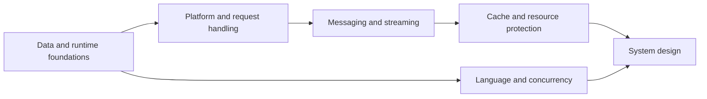

🗓️ 17102026 2125

# backend

This map organizes backend engineering notes from core mechanisms to production design. Use the topic maps for deeper paths, then follow the worked designs to connect the concepts.

## Reading path

1. **Data and storage foundations:** Read [[concepts/index]] for indexes, transactions, concurrency, and replication. Then compare [[os/virtual_memory]], [[os/page_cache]], and [[os/linux_cgroups]] to understand how the operating system manages memory and resource limits.
2. **Data platforms:** Read [[data_systems/oltp_vs_olap]], then [[data_systems/storage_computing_architectures]], [[data_systems/storage_disaggregation_architecture]], and [[data_systems/processing_architectures]]. Continue with the relevant warehouse, lakehouse, or streaming notes.
3. **Request handling:** Read [[api/index]] for HTTP semantics, inbound limits, retries, and failure isolation. Use [[transport/realtime_patterns_comparison]] when choosing a client update protocol.
4. **Messaging and streaming:** Read [[messaging/index]] for message delivery and Kafka. Continue with the Flink notes when processing needs event time, state, or recovery.
5. **Caching and resource protection:** Read [[caching/index]], then [[rate_limiting/concepts]] and [[rate_limiting/algorithms]]. Compare local coordination with [[distributed_lock]].
6. **Language and runtime behavior:** For Go, start at [[go/learning_plan]]. For JVM concurrency, use [[jvm/index]]. Follow framework notes after their runtime foundations.
7. **System design:** Read [[system_design/index]] and apply its framework to the worked designs.

## Choose by question

- How does a database find and protect data? Start with moc db internals.
- What happens when a service or dependency slows down? Start with moc api resilience.
- How do messages survive retries and failures? Start with moc messaging.
- How should a cache behave during misses or source outages? Start with moc caching.
- How do Go services coordinate and shut down? Start with go learning plan.
- How do JVM threads share state? Start with moc jvm concurrency.
- How do I turn requirements into an architecture? Start with moc system design.

