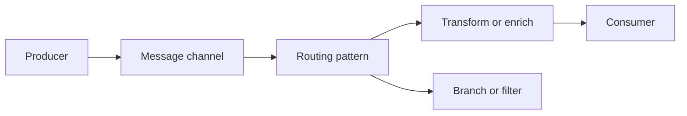

🗓️ 17102026 2135

# eip_overview

Enterprise Integration Patterns (EIPs) name reusable ways to connect applications and move messages between them.

An EIP describes a problem and a solution shape, such as routing a message, translating its format, or enriching it with data. It is a design vocabulary, not a required framework or wire protocol. Apache Camel implements many EIPs as route steps.

When choosing a pattern, identify the integration problem first, then account for delivery guarantees, ordering, failures, and observability. A pattern name alone does not determine those runtime properties.

For routing messages through a system, see [[message_routing_architecture]]. For adding information to a message, see [[content_enricher]]. For translating message formats, see [[translator_pattern]]. For messaging patterns and concepts, see [[messaging/index]].

## References

- [Apache Camel: EIP patterns](https://camel.apache.org/components/4.14.x/eips/enterprise-integration-patterns.html)
