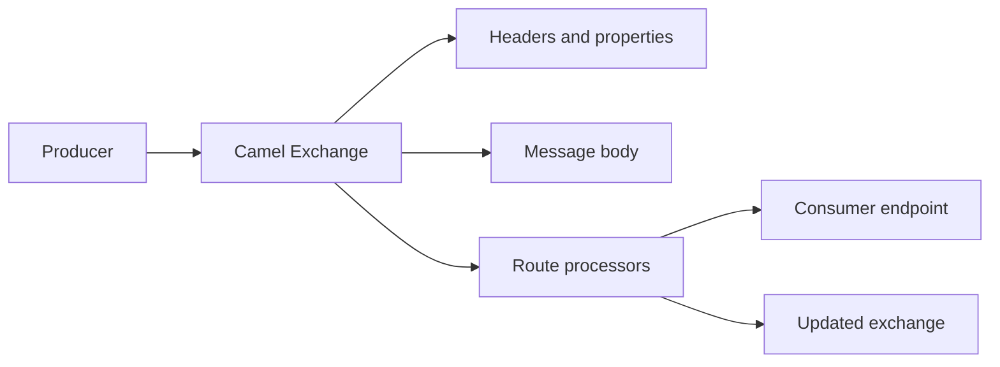

🗓️ 17102026 2135

# exchange

An Apache Camel `Exchange` is the message container that moves through a route.

It holds the current message, exchange-scoped properties, an optional exception, and an exchange pattern. A message contains a body and headers. Use headers for message metadata that may be relevant to components; use exchange properties for state that should remain inside the route and should not be sent as message headers.

The exchange pattern indicates whether the interaction is one-way (`InOnly`) or request/reply (`InOut`). In an `InOut` exchange, an output message represents the reply. The pattern is part of the route's interaction contract; it does not change how every processor handles the current message.

For integration pattern vocabulary, see [[eip_overview]]. For moving exchanges through routes, see [[message_routing_architecture]].

## References

- [Apache Camel: Message Exchange](https://camel.apache.org/manual/exchange.html)
- [Apache Camel: Exchange Pattern](https://camel.apache.org/manual/exchange-pattern.html)
