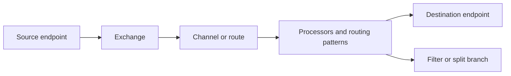

🗓️ 05042024 1804

# message_routing_architecture

![[camel_architecture.png]]

| Terms        | Additional info                                                    |
| ------------ | ------------------------------------------------------------------ |
| camelContext | contains everything in the camel runtime                           |
| DSL          | Domain Specific Language- Defines _EIPS_- Defines _routes_         |
| components   | - Provide an `endpoint` interface- For connecting to other systems |
| routes       | Tells `camel` how _messages_ should be routed between systems      |
| processors   | handle things in between endpoints                                 |

```ad-important
Route has:
	- Exactly 1 _input_ endpoint
	- 0,1 or more _output_ endpoints
```

---



## References

- https://camel.apache.org/manual/architecture.html
