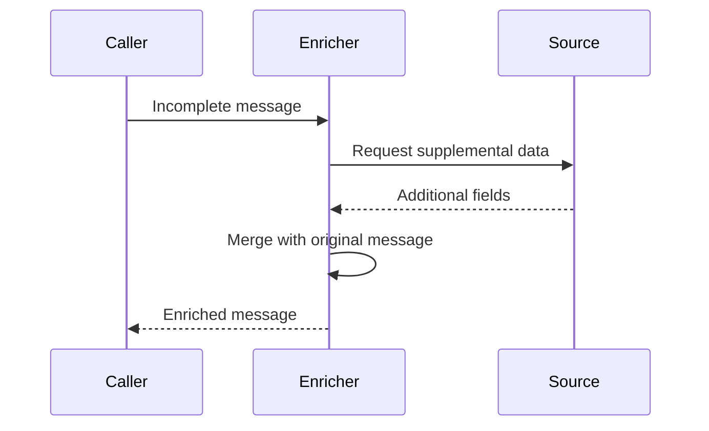

🗓️ 04042024 1505

# content_enricher

## Background

- `target` system usually requires more information that `source` system can provide
- Example below
  - Scheduling system: `source`
  - Accounting system: `target`
  - Customer Care: `dataSource` (contains additional information that scheduling does not have)

## Pattern

![[eip_content_enricher.png]]

### Benefits

- No modification to CC / Scheduling system (might not be able to in the first place)
- Loose coupling between `source` and `target`
  - Albeit tight coupling between `enricher` and `dataSource`
  - But this is ok because of the inherent nature of the data

---

## References

- Enterprise Integration Patterns by Gregor Hohpe, Bobby Woolf
