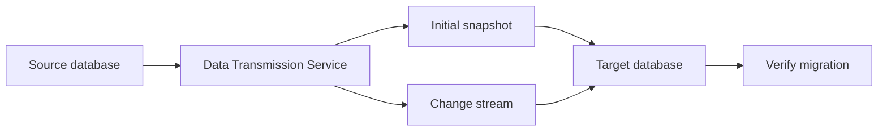

🗓️ 04042024 0940

# dts_overview

```ad-tldr
Service for migrating / replicating data
```

### Use cases

- High availability
- Remote real time backup
- Real time data integration
- Cache refresh

### Benefits

- Zero downtime (source DB can keep running)
- Supports most databases
  - Homogenous migrations > DBs on same platforms (e.g. MySQL to mySQL)
  - Heterogenous migrations > DBs on different platforms (e.g. MySQL to mySQL)
- Reliable
  - Source / target DBs continuously monitored
  - Connection optimised accordingly
- High performance
  - Data compression
  - Parallel connections
  - Network optimisation features

### Diagrams

![[dts_how_it_works_1.png]]
![[dts_how_it_works_2.png]]

![[dts_how_it_works_3.png]]
![[dts_how_it_works_4.png]]
![[dts_how_it_works_5.png]]
![[dts_how_it_works_6.png]]

---



## References

- https://www.alibabacloud.com/en/product/data-transmission-service?_p_lc=1
