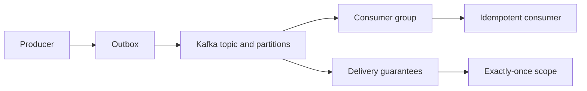

🗓️ 29042026 2130

# moc_messaging

> Map of Content for the messaging concept cluster — Kafka architecture, delivery semantics, and the patterns that make at-least-once delivery safe.

## Concept Order

### Architecture
1. [[kafka_architecture]] — broker / topic / partition / consumer group / offset.
2. [[kafka_partition_ordering_keying]] — keying strategy and ordering guarantees.

### Delivery Semantics
3. [[delivery_semantics_at_most_at_least_exactly]] — the three delivery guarantees and what they cost.
4. [[exactly_once_semantics]] — Kafka's idempotent producer + transactions (existing).

### Patterns
5. [[outbox_pattern]] — producer side; atomic DB write + reliable message publish.
6. [[idempotent_consumer_pattern]] — consumer side; survive at-least-once redelivery.

### Existing in Cluster
- [[queue]] — the broader messaging primitive (existing).
- [[kafka_cli_cheatsheet]] — operational commands (existing).
- [[stream_processing_fundamentals]] — stream processing on top of Kafka (existing).

### Planned
- `kafka_consumer_rebalancing` — group coordinator and partition reassignment.
- `kafka_isr_replication_acks` — durability deeper than this MOC covers.
- `dead_letter_queue` — handling poison messages and exhausted retries.
- `pull_vs_push_messaging` — Kafka pull model vs RabbitMQ push, trade-offs.

## How to Use This MOC

- **First pass**: architecture before semantics before patterns. Each layer assumes the previous.
- **Second pass**: pair semantics with patterns — at-least-once is the realistic baseline; the patterns are how you make it safe.
- **Application drill**: take a real flow (order placed → inventory reserved → payment charged → shipping scheduled) and trace which guarantees and patterns each step needs.

## Bridges to Other Domains

- → DB internals: outbox pattern is half-DB-half-messaging; [[saga_pattern]] strings idempotent consumers together.
- → Distributed systems: exactly once semantics depends on consensus (raft); ordering ties back to consistency models.
- → Caching: outbox pattern also handles cache invalidation via events.
- → Reliability: `circuit_breaker_pattern` *(planned)*, `retry_backoff_jitter` *(planned)* — the at-least-once ecosystem.
