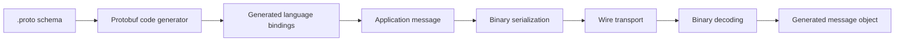

🗓️ 17102026 2135

# protobuf_overview

Protocol Buffers (protobuf) is a language-neutral format for defining structured messages and encoding them into a compact wire representation.

Developers define message types in `.proto` files, then use `protoc` and language-specific plugins to generate code. Generated code serializes and parses messages for files, network protocols, or other byte streams. The schema's field numbers are part of the wire format, so they must remain stable.

Adding a field can be compatible when old and new readers follow protobuf's rules, but compatibility is not automatic for every schema edit. Never reuse a deleted field number; reserve it. Test compatibility across deployed producer and consumer versions, and follow guidance for the syntax or edition used by the project.

Protobuf is often smaller than text formats for suitable data, but speed and size depend on the schema, payload, and workload. Benchmark before choosing it solely for performance.

For runtime implementation discovery, see [[service_provider_interface]]. For messaging and serialization context, see [[moc_messaging]].

## References

- [Protocol Buffers: Overview](https://protobuf.dev/overview/)
- [Protocol Buffers: Updating a message type](https://protobuf.dev/programming-guides/proto3/#updating)
- [Protocol Buffers: Editions overview](https://protobuf.dev/editions/overview/)
