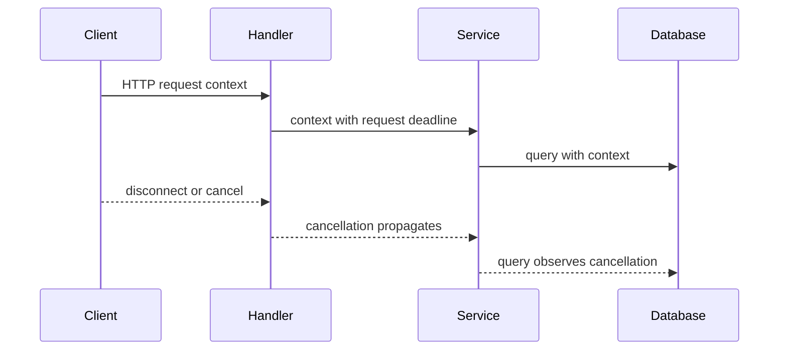

🗓️ 02112024 2302

# context

A Go context carries cancellation signals, deadlines, and request-scoped values across API boundaries. It lets callers signal downstream work when its result is no longer needed.

## Terms

| Term | Definition | Source |
|---|---|---|
| **Context** | A value that carries deadlines, cancellation signals, and request-scoped values across API boundaries. | [Go package documentation](https://pkg.go.dev/context) |
| **Cancellation** | A signal that work should stop because its result is no longer needed. A context's `Done` channel carries this signal. | [Go package documentation](https://pkg.go.dev/context) |
| **Deadline** | The time after which work associated with a context should stop. A derived context can inherit an earlier parent deadline. | [Go package documentation](https://pkg.go.dev/context) |

## Propagation

The request handler receives a context, derives a narrower deadline when needed, and passes it to each operation. A called function must cooperate by passing the context to APIs that support cancellation or by checking `Done` itself.



```go
func fetchUser(parent context.Context, id string) (User, error) {
	ctx, cancel := context.WithTimeout(parent, 3*time.Second)
	defer cancel()

	return db.QueryUser(ctx, id)
}
```

The database driver must honor the context for the query to stop. Calling the cancel function releases resources associated with the derived context, even when the query finishes early.

## Rules

- Pass `context.Context` as the first parameter, usually named `ctx`.
- Pass it explicitly; do not store request contexts in structs.
- Use context values for request-scoped data crossing API boundaries, not optional parameters.
- Call the returned cancel function when finished with a derived context.
- A canceled context signals work to stop; it does not forcibly terminate a goroutine.

Use `context.Background()` as a root context for application startup, tests, and `main`.

## References

- [Go package documentation: context](https://pkg.go.dev/context)
- [Go: Canceling in-progress operations](https://go.dev/doc/database/cancel-operations)
