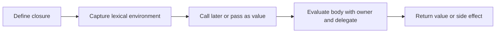

🗓️ 17102026 2135

# groovy_closures

A Groovy closure is an executable object that can be stored, passed, and called like a value.

## Basic form

```groovy
def greet = { name -> "Hello, $name" }
assert greet("Ada") == "Hello, Ada"
```

The parameter list is optional. When omitted, Groovy provides the implicit parameter `it`. A closure can refer to variables from its surrounding scope, so it can carry context into a callback.

Closures also have `owner`, `delegate`, and `thisObject` references. DSLs often use a delegate to resolve method and property calls against a target object. That flexibility is useful, but can make name resolution less obvious; inspect the delegation strategy when a DSL call behaves unexpectedly.

## Where they appear

Closures are common in collection operations, callbacks, build scripts, and Groovy DSLs. A Groovy closure is a `groovy.lang.Closure` object; Java lambdas have different runtime and delegation behavior.

For another JVM expression language, see [[mvel_overview]].



## References

- [Groovy documentation: Closures](https://docs.groovy-lang.org/latest/html/documentation/core-closures.html)
