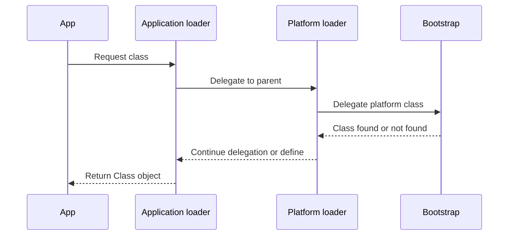

🗓️ 17102026 2135

# class_loading

A Java class loader turns a class's binary name into a runtime `Class` definition and associates that class with its defining loader.

## Built-in loaders

On Java 9 and later, the runtime provides:

- **Bootstrap loader:** built into the VM; commonly represented by `null` in the API.
- **Platform loader:** loads platform classes and is the parent or an ancestor of the application loader.
- **System/application loader:** normally loads application classes from the class path and module path.

The old extension class loader and `jre/lib/ext` mechanism were removed in Java 9. Older notes describing bootstrap, extension, and application loaders apply to earlier JDKs.

## Delegation and identity

The default `ClassLoader` strategy delegates to its parent before searching locally. Custom loaders can change this behavior for plugin isolation or application servers. A class is identified by both its binary name and its defining class loader; two classes with the same name from different loaders are distinct types and can cause `ClassCastException` when mixed.

Class loading includes loading, linking (verification, preparation, and resolution), and initialization. Static initializers run during initialization, which is distinct from simply finding the class bytes.

For discovering implementations through `ServiceLoader`, see [[service_provider_interface]]. For packaging class files and resources, see [[jar_types]].

## References

- [Java 17 API: ClassLoader](https://docs.oracle.com/en/java/javase/17/docs/api/java.base/java/lang/ClassLoader.html)
- [Java 17 Virtual Machine Specification: Loading, Linking, and Initialization](https://docs.oracle.com/javase/specs/jvms/se17/html/jvms-5.html)
