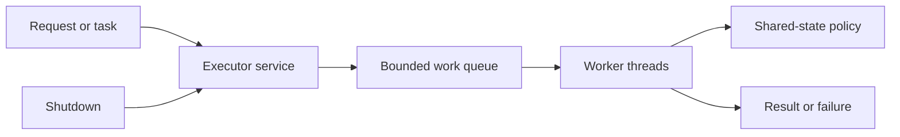

🗓️ 27082025 2330

# concurrency_guidelines

### **Impact Levels**

| Impact Level    | Meaning                                                                    | Examples                                                |
| --------------- | -------------------------------------------------------------------------- | ------------------------------------------------------- |
| 🚨 **Critical** | Must fix immediately; could cause severe outages, data loss, or avalanches | Unbounded queues, inconsistent locks, ThreadLocal leaks |
| ⚠️ **High**     | Should fix promptly; could affect stability or performance                 | Missing Future timeouts, bad collection choice          |
| 🟢 **Advisory** | Best practice; improves maintainability and efficiency                     | Thread naming, Random vs ThreadLocalRandom              |

## 🧵 Thread Management

| Guideline                                           | Impact      | Why It Matters                                                                         |
| --------------------------------------------------- | ----------- | -------------------------------------------------------------------------------------- |
| **Limit total threads** to `≤ min(5000, 200 * CPU)` | ⚠️ High     | Too many threads → context switching overhead + system jitter                          |
| **Avoid parallel streams for I/O**                  | 🚨 Critical | Parallel streams share the **ForkJoinPool** → I/O blocks all tasks, harming latency    |
| **Clean up `ThreadLocal` variables after use**      | 🚨 Critical | Thread pools reuse threads → stale data leaks + unexpected cross-request contamination |
| **Always handle `CompletableFuture` exceptions**    | ⚠️ High     | Uncaught exceptions are **silently dropped** → makes debugging difficult               |
| **Use custom thread pools for `CompletableFuture`** | 🚨 Critical | Default pool = small, shared → risk of starvation or excessive thread creation         |
| **Set timeouts on `Future.get()`**                  | ⚠️ High     | Without timeouts, a blocked future can **hang threads indefinitely**                   |

## 🏊‍♀️ Thread Pool Best Practices

| Guideline                                                  | Impact                                 | Why It Matters                                                          |
| ---------------------------------------------------------- | -------------------------------------- | ----------------------------------------------------------------------- |
| Core threads **≈ max threads**                             | 🟢 Advisory                            | Avoids frequent creation/destruction > better latency and CPU usage     |
| **Keep-alive ≥ 1 min**                                     | ⚠️ High if < 30s, 🚨 Critical if < 10s | Short lifetimes thrash thread creation, increasing CPU spikes           |
| **Avoid unbounded queues**                                 | 🚨 Critical                            | Tasks pile up > unbounded memory growth > OOM risk                      |
| **Specify custom pools for `@Async`**                      | 🚨 Critical                            | Default Spring async pool is **unbounded** > uncontrolled thread growth |
| **Specify custom pools for WebAsyncTask / DeferredResult** | 🚨 Critical                            | Defaults to shared pool > contention under high traffic                 |
| **Name threads meaningfully**                              | 🟢 Advisory                            | Helps debugging via `jstack` and log tracing                            |

## 🛡️ Thread Safety Guidelines

| Guideline                                                                   | Impact      | Why It Matters                                                           |
| --------------------------------------------------------------------------- | ----------- | ------------------------------------------------------------------------ |
| Use **proper double-checked locking**                                       | 🚨 Critical | Incorrect ordering → partially initialized objects → undefined behavior  |
| **Don’t start threads in constructors**                                     | ⚠️ High     | Threads may run **before subclass initialization** → inconsistent state  |
| **Don’t synchronize on value types** (`String`, `Integer`, `LocalDateTime`) | 🚨 Critical | Value types are cached internally → accidental cross-object lock sharing |
| Prefer **`DateTimeFormatter`** over `SimpleDateFormat`                      | 🟢 Advisory | `SimpleDateFormat` is **not thread-safe**; race conditions likely        |
| **Keep lock acquisition order consistent**                                  | 🚨 Critical | Inconsistent ordering → **deadlocks** under load                         |

## 🚀 Concurrent Performance Optimization

| Guideline                                                     | Impact      | Why It Matters                                                |
| ------------------------------------------------------------- | ----------- | ------------------------------------------------------------- |
| Use **ConcurrentHashMap** instead of `HashMap + synchronized` | ⚠️ High     | Fine-grained locking in ConcurrentHashMap → better throughput |
| **Minimize lock scope**                                       | ⚠️ High     | Smaller critical sections → higher concurrency, less blocking |
| Use **ThreadLocalRandom** instead of `Random`                 | 🟢 Advisory | Avoids contention on shared Random state                      |
| Use **LongAdder** instead of `AtomicLong` for hot counters    | 🟢 Advisory | Better under high contention due to striped counters          |

## 📌 Quick Prioritization Table

|Area|Must-Fix 🚨|Should-Fix ⚠️|Best Practice 🟢|
|---|---|---|---|
|**Threads**|Parallel I/O streams, ThreadLocal leaks, custom pool for CFutures|Thread limits, Future timeouts|Thread naming|
|**Pools**|Unbounded queues, default `@Async`, default WebAsyncTask pools|Keep-alive tuning|Core=max threads|
|**Safety**|Lock order consistency, bad value locks, bad DCL patterns|Starting threads in constructors|Use DateTimeFormatter|
|**Performance**|—|ConcurrentHashMap, lock minimization|LongAdder, ThreadLocalRandom|

### **Key Insights**
- The **Critical** rules are mostly about **preventing outages** (e.g., OOM, deadlocks, cascading failures).
- The **High** rules aim at **avoiding silent performance killers** (e.g., starvation, slow I/O).
- The **Advisory** rules improve **debuggability, maintainability, and long-term scalability**.

---
## References
- [Java 17 API: java.util.concurrent](https://docs.oracle.com/en/java/javase/17/docs/api/java.base/java/util/concurrent/package-summary.html)
- [Java Language Specification: Threads and Locks](https://docs.oracle.com/javase/specs/jls/se17/html/jls-17.html)
