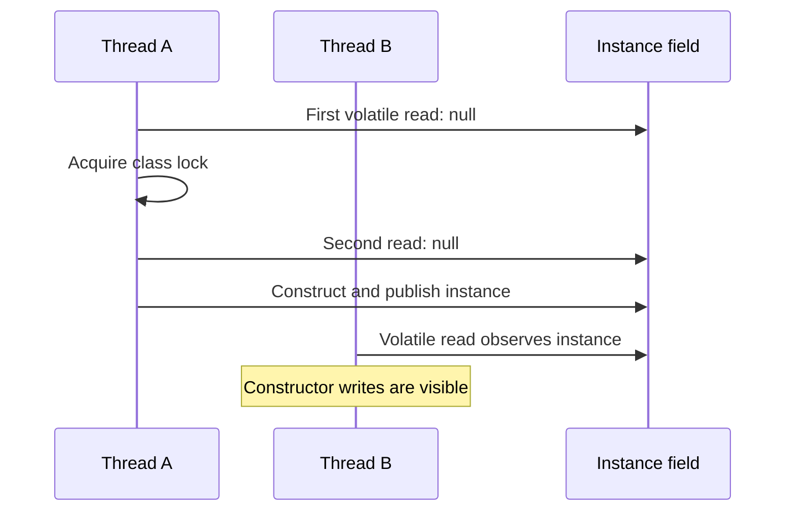

🗓️ 13032026 1200

# double_checked_locking



## Pattern
```java
CachedToken current = tokenCache.get(appId);
if (current != null && !current.isExpired()) {
    return current.token;  // fast path — no lock needed
}
synchronized (lock) {
    // re-check: another thread may have refreshed while we waited for the lock
    current = tokenCache.get(appId);
    if (current != null && !current.isExpired()) {
        return current.token;
    }
    return refreshToken(appConfig);
}
```

## Why Two Checks?
- **First check** avoids locking when value is already cached (majority of calls)
- **Second check** inside `synchronized` prevents duplicate refresh from racing threads

## Visibility Requirement
The shared variable must be safely published. Either:
- Use `volatile` on the reference, or
- Use a thread-safe collection (e.g. `ConcurrentHashMap`) so readers see the latest write

Without proper visibility guarantees, the first (unsynchronized) check may read a **partially constructed** object due to instruction reordering (see [[cpu_cache_and_memory_visibility]]).

---
## References
- [[synchronized]]
- cpu cache and memory visibility
