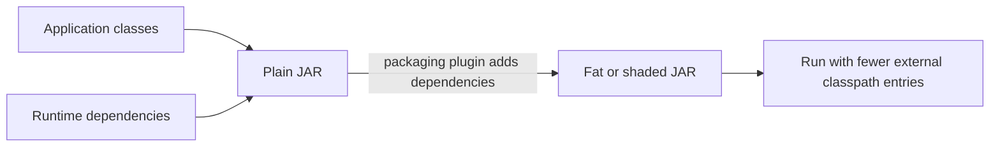

🗓️ 28082025 1056

# jar_types


## 🎯 Core Concept
- **Plain JAR** = Library (shareable code)
- **Boot JAR** = Application (runnable program)

## 📊 Key Differences

| | Plain JAR | Boot JAR |
|--|-----------|----------|
| **Size** | Small (~KB-MB) | Large (50-500MB) |
| **Contents** | Your classes only | Your classes + ALL dependencies |
| **Executable** | ❌ No | ✅ `java -jar app.jar` |
| **As Dependency** | ✅ Yes | ❌ No (nested structure) |

## 🔧 Maven Solution (Multi-module projects)

```xml
<!-- Generate BOTH plain + boot JARs -->
<plugin>
    <groupId>org.springframework.boot</groupId>
    <artifactId>spring-boot-maven-plugin</artifactId>
    <executions>
        <execution>
            <goals><goal>repackage</goal></goals>
            <configuration>
                <classifier>boot</classifier>  <!-- 🔑 Magic line -->
            </configuration>
        </execution>
    </executions>
</plugin>
```

**Result:**
- `app-1.0.jar` → Plain JAR (for dependencies)
- `app-1.0-boot.jar` → Boot JAR (for execution)

## ⚡ Quick Mental Model
- Plain JAR = 📚 Library book (others can reference)
- Boot JAR = 🎬 Complete movie (self-contained entertainment)

## 🚨 Common Problem
**Error**: `unable to resolve class` in multi-module projects
**Cause**: Spring Boot only generates boot JARs by default
**Fix**: Add `<classifier>boot</classifier>` to generate both types

---
## References
- [Java 17: The jar Command](https://docs.oracle.com/en/java/javase/17/docs/specs/man/jar.html)
