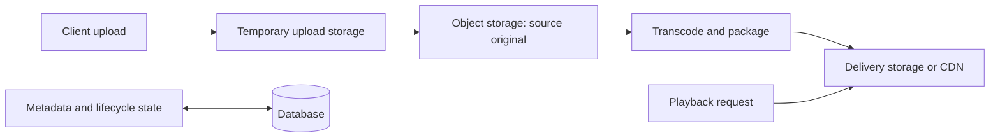

🗓️ 09092025 1153

# video_storage_strategy

Video storage works best when upload reliability, durable originals, and playback delivery use separate paths. Keep large binary data in object storage; use the database for metadata and references.

## Storage roles

- **Temporary storage** holds incomplete uploads until assembly or validation finishes. Apply cleanup rules so abandoned parts do not accumulate.
- **Object storage** keeps the durable source file and generated renditions. Store metadata and object keys in the database.
- **Delivery storage** serves playback renditions through a CDN or equivalent cache. Cache lifetime should match how quickly content can change or be revoked.

Separate upload from playback because they have different access patterns. Uploads need resumability and validation; playback needs low-latency reads and suitable renditions.

## Decisions

- Use multipart or resumable upload for large files and unreliable connections.
- Transcode when client compatibility or bandwidth requires it; retain the source when future reprocessing matters.
- Set lifecycle and deletion policies for temporary parts, originals, and derived files.
- Keep authorization checks in the application and use scoped access for delivery where needed.

## References

- [Apple: HTTP Live Streaming](https://developer.apple.com/documentation/http-live-streaming)
- [AWS Elemental MediaConvert: Supported inputs and outputs](https://docs.aws.amazon.com/mediaconvert/latest/ug/supported-inputs-outputs.html)

- [Apple: HTTP Live Streaming](https://developer.apple.com/documentation/http-live-streaming)
- [AWS Elemental MediaConvert: Supported inputs and outputs](https://docs.aws.amazon.com/mediaconvert/latest/ug/supported-inputs-outputs.html)
