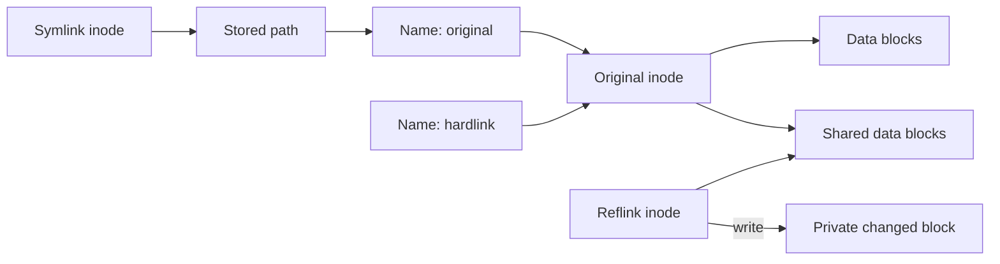

🗓️ 17102026 2111

# file_links

**What it is:**
- Mechanisms for making one path reference another file's data without copying it
- Three types: **hardlinks**, **symbolic links (symlinks)**, and **reflinks**
- Each has different trade-offs around durability, portability, and filesystem constraints

**Why it matters:**
- Package managers like pnpm use hardlinks to avoid duplicating packages — 10 projects sharing `lodash` store it once on disk
- Filesystem boundaries explain when links can share data and when a copy is required

## Hardlinks



A hardlink is a **second directory entry pointing to the same [[inodes]]**.

```
# Create a hardlink
ln original.txt link.txt

# Both names point to the same inode
$ ls -i original.txt link.txt
9012 original.txt
9012 link.txt     # same inode number
```

Properties:
- Indistinguishable from the "original" — both names are equally valid references to the same data
- Modifying data through either name changes the same underlying blocks
- Deleting one name just decrements the inode's link count; data survives until count reaches 0
- No extra disk space used (it's just a directory entry, not a copy)

### Hardlink constraints

- **Cannot cross filesystem boundaries**: inodes are per-filesystem, so a hardlink on filesystem A cannot reference an inode on filesystem B
- **Cannot link to directories** (on most systems): would create filesystem cycles that break tools like `find`
- **Both paths must be on the same mounted filesystem**

Hardlinks cannot cross filesystem boundaries. A container build may use a different filesystem from the host, so a host-side package store cannot be assumed to support hardlinking into the build. The result depends on where the builder's package store and project files are mounted.

## Symbolic Links (Symlinks)

A symlink is a **special file that stores a path string** pointing to another file.

```
# Create a symlink
ln -s /home/user/original.txt link.txt

# link.txt is a separate inode that contains the path "/home/user/original.txt"
$ ls -i original.txt link.txt
9012 original.txt
3456 link.txt      # different inode
```

Properties:
- Has its own inode — it's a distinct file whose content is a path string
- OS transparently follows the path when you read through the symlink
- **Can cross filesystem boundaries** (it's just a string, not an inode reference)
- **Can link to directories**
- Can become a **dangling symlink** if the target is deleted or moved

### Symlink vs hardlink

| | Hardlink | Symlink |
|---|---|---|
| Mechanism | Same inode, second directory entry | Separate file storing a path string |
| Cross filesystem | No | Yes |
| Link to directory | No | Yes |
| Target deleted | Data survives (link count > 0) | Dangling link (broken) |
| Extra disk space | None (just a directory entry) | Tiny (stores path string) |
| Performance | Direct inode access | Extra lookup to resolve path |

## Reflinks (Copy-on-Write Links)

A reflink creates a **new inode that shares the same data blocks** as the original, with copy-on-write semantics.

```
# Create a reflink (on supported filesystems)
cp --reflink=always original.txt copy.txt
```

Properties:
- Looks and behaves like an independent copy — separate inode, separate metadata
- But the underlying data blocks are shared until one file is modified
- On modification, only the changed blocks are copied ([[copy_on_write]]) — the rest stay shared
- **Instant** and **zero extra space** at creation time, unlike a regular copy
- Space grows only as files diverge

### Reflink constraints

- **Filesystem must support it**: reflink support depends on the filesystem and its configuration
- **Cannot cross filesystem boundaries**: like hardlinks, shared data blocks must be on the same filesystem
- Not all tools use reflinks by default — must explicitly request with `cp --reflink`

### Why pnpm cares

pnpm links files from its content-addressable store into `node_modules`, using hardlinks or reflinks when supported. Links require compatible filesystem placement. Otherwise, pnpm may copy files, which uses more space and time. ([pnpm store docs](https://pnpm.io/settings#store-dir))

Docker BuildKit cache mounts can preserve package-manager cache data between builds and reduce repeated downloads. They do not guarantee hardlink or reflink behavior; that still depends on the filesystem used by the builder. ([Docker build cache docs](https://docs.docker.com/build/cache/optimize/))

```ad-warning
**Filesystem boundary**: Hardlinks and reflinks cannot share data across filesystems. A package manager must copy files when its store and target cannot share the required filesystem resources.
```

```ad-example
**Check link type**: `stat file.txt` shows the link count (hardlinks). `ls -l file.txt` shows `l` prefix and `->` target for symlinks. For reflinks, there's no simple way to tell — `filefrag -v` on Linux can show shared extents, but reflinks are designed to be transparent.
```

---

## References

- https://man7.org/linux/man-pages/man2/link.2.html
- https://man7.org/linux/man-pages/man2/symlink.2.html
- https://man7.org/linux/man-pages/man2/copy_file_range.2.html
- https://btrfs.readthedocs.io/en/latest/Reflink.html
- [pnpm: Store settings](https://pnpm.io/settings#store-dir)
- [Docker: Optimize build cache](https://docs.docker.com/build/cache/optimize/)
