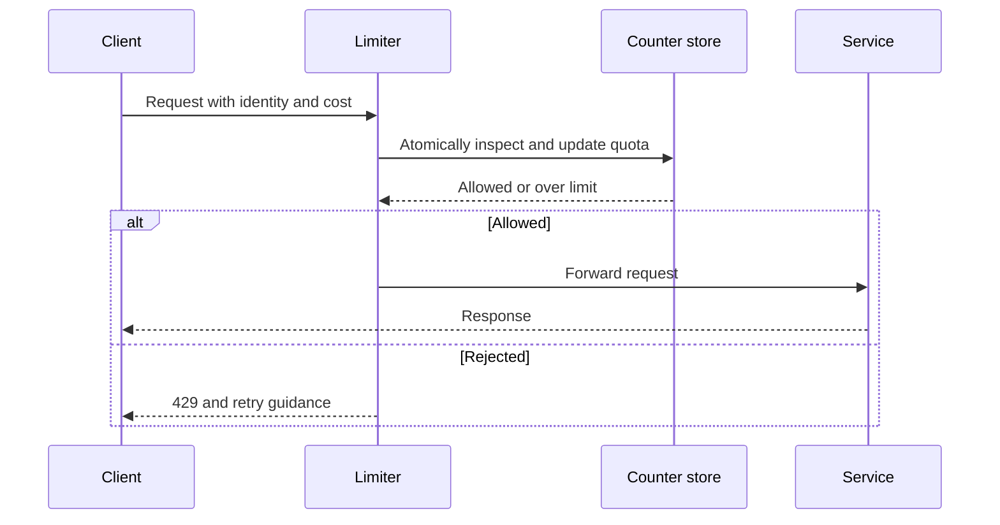

🗓️ 03062024 1644

# concepts

- Mechanisms for preventing frequency of an operation from exceeding some constraint

##   Why Used

- **Protecting shared services from excessive use** - maintain service availability
- On both server (limit on consumption) and client
  - Maximizes throughput
  - Minimizes end to end latency
  - Prevents [cascading failure](https://sre.google/sre-book/addressing-cascading-failures/)

##   Use Cases

###   Prevents resource starvation

- Problem in concurrent computing where a process is **perpetually denied necessary resources** to process its work
- Friendly DDOS
- Use case: Friendly API - underlying DB

###   Managing policies and quotas

- Quotas - rate and allocation limits
- Can be applied to users
- Ways of applying rate limits
  - Over long period of time
  - Quantity allocated

###   Controlling flow

- Merging streams into single service
- Distributing work stream to multiple workers

###   Avoiding excess costs

- Prevent underlying resources that are capable of auto-scaling from spending too much $

##   Strategies

- Context: chain or mesh of services - many nodes can be both clients and servers
- Each part can choose to
  - No rate limiting strategy
  - One or more in different ways
- Client should be engineered to react appropriately even if rate limiting is implemented entirely on server side
- Considerations
  - Fail Open vs Fail Close
    - Requires knowledge about client retry techniques

###   Server Side

###     No Rate Limiting

- Robust error handling error in system
- Understand what users will receive in those situations
- Ensure:
  - No sensitive data leaked
  - Useful error codes provided
- Useful mechanisms:
  - Timeouts
  - Deadlines
  - Circuit breaking patterns

###     Pass Through

- Call other services to fulfill requests
- Pass rate limiting signal from those services to caller
- Options
  - Forward rate limiting response from downstream service to caller
  - Enforce rate limits on behalf of service and block the caller
- Status code 429

###     Enforce Rate Limits

- Most common
- When downstream service has no way to protect itself (e.g. Legacy systems)
- Considerations:
  - Understand why it is being applied
  - Determine which attributes of the request to use as limiting key
    - Source IP, User, API Key etc.
  - Use limiting key to track usage (reached => return limiting signal 429 HTTP response)

###     Defer response

- When to use:
  - Computing response is computationally expensive / time consuming
  - Easiest to apply when immediate response holds no real information
- If overused => Increased Complexity and failure modes of system
- Benefits
  - Higher availability
  - Reduces compute efforts for clients that might be doing long blocking calls while waiting for response
- Strategy
  - Shunt requests into queue
  - Return job ID
  - Polling on state of job ID through event based system

###   Client Side

- Scenarios:
  - Service unreachable because of network conditions
  - Service returned non specific errors
  - Request denied because of authentication/authorization failure
  - Request invalid/malformed
  - Service rate-limits caller and sends backpressure signal (
- Response to rate-limiting:
  - Exponential backoff retries
  - Self imposed throttling
- Related concepts
  - Idempotency
  - Resilient API

##   Techniques for enforcing rate limits

###   Token Bucket

- Balance of tokens
- Service request => token withdrawn
  - Not necessarily 1:1
  - Depends on the request e.g. In Graphql service, 1 request might request in multiple API calls
- No token => backpressure

###   Leaky Bucket

- Similar to token bucket
  - Rate is limited by amount that can drip/leak out of bucket ??? Idk

###   Fixed Window

- e.g. 3000 reqs per hour / 10 reqs per day
- Susceptible to spikes at edge of window
  - e.g. 3000 reqs in first minute => service might be overwhelmed

###   Sliding Window

- Benefits of fixed window
  - Smoothens out bursts
- Redis facilitates this technique with expiring keys

---

## References

- https://cloud.google.com/architecture/rate-limiting-strategies-techniques
