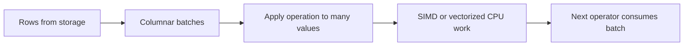

🗓️ 17102026 2135

# vectorization

Vectorized query execution processes a batch of values through an operator instead of invoking the operator once per row.

A columnar engine may pass typed vectors from one operator to the next. Batching reduces per-row dispatch overhead and can improve cache use; some operations can also use SIMD instructions. The gains depend on the operator, data representation, batch size, and hardware. Vectorization does not automatically mean parallel execution.

For example, a filter can compare a vector of prices with a threshold and produce a selection vector of matching row positions. A later projection can use those positions to build result columns. This lets the engine process many rows while preserving row-level query semantics.

For storing values by column, see [[column_oriented]]. For analytical query workloads, see [[olap]]. For broader execution choices, see [[processing_architectures]].

## References

- [DuckDB: Execution format and vectors](https://duckdb.org/docs/current/internals/vector)
