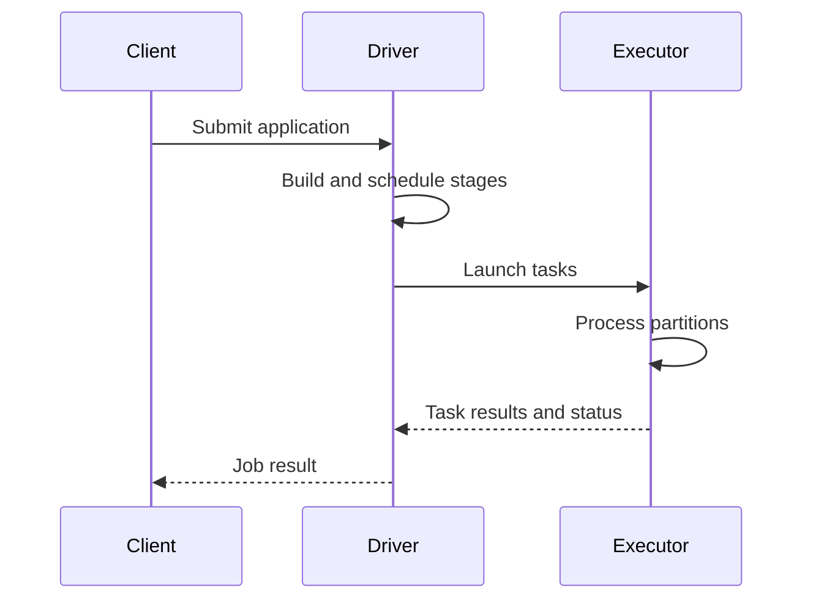

🗓️ 17102026 2135

# apache_spark

Apache Spark runs distributed data applications as coordinated driver and executor processes.

The driver creates the application context, builds work, and schedules tasks. Executors run tasks and can cache data for reuse. A cluster manager provides resources, while Spark coordinates execution across the allocated processes. An application can use Spark's SQL, batch, streaming, and machine-learning libraries where appropriate.

For a streaming workload, distinguish Spark Structured Streaming's processing model and trigger configuration from continuous low-latency streaming systems. The execution mode affects latency, throughput, and operational behavior; choose based on the workload's needs.

For common stream-processing concepts, see [[stream_processing_fundamentals]]. For a common streaming data source, see [[kafka_architecture]]. For runtime details for a streaming engine, see [[stream_processing_runtime]].

## References

- [Spark: Cluster mode overview](https://spark.apache.org/docs/latest/cluster-overview.html)
- [Spark: Structured Streaming programming guide](https://spark.apache.org/docs/latest/streaming/index.html)
