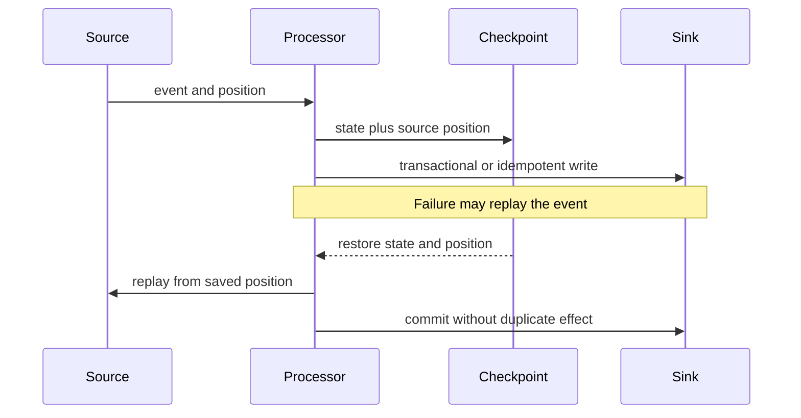

🗓️ 17102026 2135

# exactly_once_semantics

> **Exactly-once semantics**: A processing guarantee that each event affects managed state once, even if recovery replays it. End-to-end effects require compatible source and sink guarantees. ([Apache Flink](https://nightlies.apache.org/flink/flink-docs-stable/docs/learn-flink/fault_tolerance/))

This guarantee matters because stream processors recover by restoring state and replaying input.

It does not necessarily mean the code processes an event only once. A stream processor may replay an event after a failure; its checkpoint and recovery protocol ensures the replay does not apply the state update twice.

For end-to-end delivery, the source must be replayable or participate in a consistent snapshot, and the sink must support a compatible transaction or idempotent write strategy. A processor's internal exactly-once state guarantee alone does not guarantee that an external side effect occurs once.

Before relying on an “exactly once” label, check its scope: source offsets, processor state, sink writes, and what downstream readers observe may have separate guarantees.

For comparing delivery guarantees, see [[delivery_semantics_at_most_at_least_exactly]]. For flink state snapshots, see [[checkpointing]]. For reliable database-to-message publication, see [[outbox_pattern]].

## References

- [Apache Flink: Fault tolerance](https://nightlies.apache.org/flink/flink-docs-stable/docs/learn-flink/fault_tolerance/)
- [Apache Flink: Fault-tolerance guarantees for sources and sinks](https://nightlies.apache.org/flink/flink-docs-stable/docs/connectors/datastream/guarantees/)
