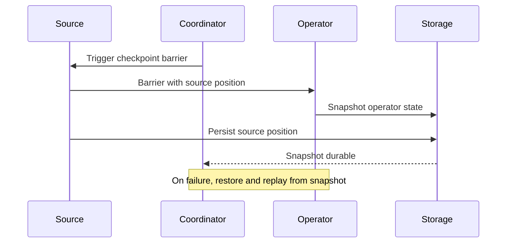

🗓️ 17102026 2135

# checkpointing

A Flink checkpoint is a consistent snapshot of operator state and source positions used to recover a job after failure.

Flink injects checkpoint barriers into input streams. Operators snapshot their state when the barriers reach them, so the checkpoint aligns the state with the corresponding source positions. On recovery, Flink restores that state and resumes sources from the saved positions.

Checkpoints require the job's state and checkpoint storage to be configured appropriately. For production recovery, use durable checkpoint storage and a source that can restore its position. End-to-end exactly-once effects also require a compatible sink; see [[exactly_once_semantics]].

Checkpoint interval, timeout, concurrent checkpoint count, and retained checkpoints affect overhead and recovery options. Tune these against state size, source throughput, storage performance, and the tolerated recovery point.

For what Flink persists, see [[state]]. For per-key managed state, see [[keyed_state]]. For user-triggered snapshots for planned changes, see [[savepoints]].

## References

- [Apache Flink: Checkpointing](https://nightlies.apache.org/flink/flink-docs-stable/docs/dev/datastream/fault-tolerance/checkpointing/)
- [Apache Flink: Fault tolerance](https://nightlies.apache.org/flink/flink-docs-stable/docs/learn-flink/fault_tolerance/)
