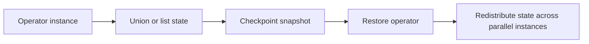

🗓️ 17102026 2135

# operator_state

Flink operator state belongs to a parallel operator instance rather than being partitioned by a record key.

It is useful when an operator must remember information that is not naturally keyed, such as source offsets, a set of pending splits, or state maintained by a sink. A user-defined function can implement `CheckpointedFunction` to snapshot and restore this state. Flink includes operator state in checkpoints, and redistribution mode determines how state is reassigned when parallelism changes.

Use [[keyed_state]] when each record should access state for its own key. Operator state instead requires the application to reason about state per subtask and how that state is repartitioned. Avoid relying on the old note's claim that it is “rarely needed”: sources and sinks are common uses, and the right choice depends on the state model.

For consistent recovery snapshots, see [[checkpointing]]. For manually triggered state snapshots, see [[savepoints]].

## References

- [Flink: Working with State](https://nightlies.apache.org/flink/flink-docs-stable/docs/dev/datastream/fault-tolerance/state/)
