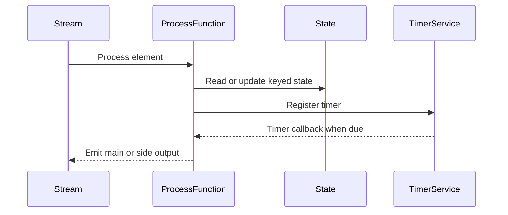

🗓️ 17012025 2042

# process_functions

```ad-abstract
A `ProcessFunction` combines event processing with timers and [[state]]

Basic for creating **event-driven applications** with Flink
```

## Comparison to [[windows]]
```java
// compute the sum of the tips per hour for each driver
DataStream<Tuple3<Long, Long, Float>> hourlyTips = fares
        .keyBy((TaxiFare fare) -> fare.driverId)
        .window(TumblingEventTimeWindows.of(Time.hours(1)))
        .process(new AddTips());
```
> Processed in time based buckets

```java
// compute the sum of the tips per hour for each driver
DataStream<Tuple3<Long, Long, Float>> hourlyTips = fares
        .keyBy((TaxiFare fare) -> fare.driverId)
        .process(new PseudoWindow(Time.hours(1)));
```
> Processing events continuously as they arrive



## Types

| Type                                                                                                                                     | Description                                                                                                                              | Use case                                                                              |
| ---------------------------------------------------------------------------------------------------------------------------------------- | ---------------------------------------------------------------------------------------------------------------------------------------- | ------------------------------------------------------------------------------------- |
| ProcessFunction                                                                                                                          | Low-level API for processing events in a **non-keyed stream**. Provides access to state and timers but without key-specific partitioning |                                                                                       |
| RichProcessFunction                                                                                                                      | An extension of ProcessFunction with additional lifecycle methods and access to runtime context for advanced use cases                   |                                                                                       |
| KeyedProcessFunction                                                                                                                     | Processes events in a **keyed stream**, allowing access to keyed state and timers                                                        | Ideal for implementing event-driven applications and custom event-time logic.         |
| CoProcessFunctions                                                                                                                       | Processes events from two connected streams                                                                                              | Enables shared state and logic for event correlation or enrichment across streams     |
| Similar to `CoProcessFunction` but specifically for **keyed streams**, enabling stateful processing of two streams keyed by the same key | Similar to `CoProcessFunction` but specifically for **keyed streams**, enabling stateful processing of two streams keyed by the same key |                                                                                       |
| BroadcastProcessFunctions                                                                                                                | Processes events from a **broadcasted stream** and a non-broadcasted stream                                                              | Useful for dynamically propagating configuration, rules, or patterns to other streams |

## Callbacks

> Functions that process functions have

- Passed a `Collector` to emit results
- Provided with a context object that can be used to interact with a `TimerService` (among other things)

### The `open()` method

```java
// Keyed, managed state, with an entry for each window, keyed by the window's end time.
// There is a separate MapState object for each driver.
private transient MapState<Long, Float> sumOfTips;

@Override
public void open(Configuration conf) {

    MapStateDescriptor<Long, Float> sumDesc =
            new MapStateDescriptor<>("sumOfTips", Long.class, Float.class);
    sumOfTips = getRuntimeContext().getMapState(sumDesc);
}
```

- Because the fare events can arrive out of order, it will sometimes be necessary to process events for one hour before having finished computing the results for the previous hour
- In fact, if the watermarking delay is much longer than the window length, then there may be many windows open simultaneously, rather than just two
- This implementation supports this by using a `MapState` that maps the timestamp for the end of each window to the sum of the tips for that window.

### `processElement()`
- Called with each element
```java
public void processElement(
        TaxiFare fare,
        Context ctx,
        Collector<Tuple3<Long, Long, Float>> out) throws Exception {

    long eventTime = fare.getEventTime();
    TimerService timerService = ctx.timerService();

    if (eventTime <= timerService.currentWatermark()) {
        // This event is late; its window has already been triggered.
    } else {
        // Round up eventTime to the end of the window containing this event.
        long endOfWindow = (eventTime - (eventTime % durationMsec) + durationMsec - 1);

        // Schedule a callback for when the window has been completed.
        timerService.registerEventTimeTimer(endOfWindow);

        // Add this fare's tip to the running total for that window.
        Float sum = sumOfTips.get(endOfWindow);
        if (sum == null) {
            sum = 0.0F;
        }
        sum += fare.tip;
        sumOfTips.put(endOfWindow, sum);
    }
}
```

- This example uses a `MapState` where the keys are timestamps, and sets a `Timer` for that same timestamp. This is a common pattern; it makes it easy and efficient to lookup relevant information when the timer fires.

### `onTimer()`
- Called when timer is fired
- Can be event time / processing time timers
- The `OnTimerContext context` passed in to `onTimer` can be used to determine the current key.

```java
public void onTimer(
        long timestamp, 
        OnTimerContext context, 
        Collector<Tuple3<Long, Long, Float>> out) throws Exception {

    long driverId = context.getCurrentKey();
    // Look up the result for the hour that just ended.
    Float sumOfTips = this.sumOfTips.get(timestamp);

    Tuple3<Long, Long, Float> result = Tuple3.of(driverId, timestamp, sumOfTips);
    out.collect(result);
    this.sumOfTips.remove(timestamp);
}
```

**Observations**:
- Our pseudo-windows are being triggered when the current watermark reaches the end of each hour, at which point `onTimer` is called
- This onTimer method removes the related entry from `sumOfTips`, which has the effect of making it impossible to accommodate late events
- Equivalent of setting the allowedLateness to zero when working with Flink’s time windows.

## Performance Considerations

- Flink provides `MapState` and `ListState` types that are optimized for RocksDB
- Where possible, these should be used instead of a `ValueState` object holding some sort of collection

```ad-info
The RocksDB state backend can append to `ListState` without going through (de)serialization, and for `MapState`, each key/value pair is a separate RocksDB object, so `MapState` can be efficiently accessed and updated.
```

---

## References
- https://nightlies.apache.org/flink/flink-docs-release-1.20/docs/learn-flink/event_driven/#process-functions
