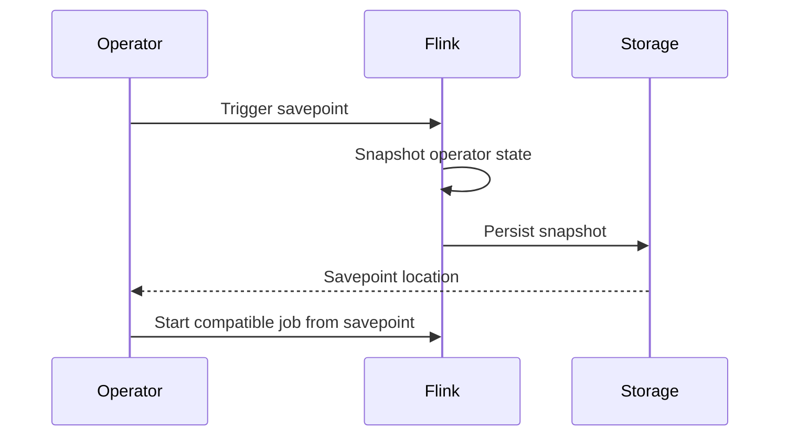

🗓️ 18022025 1441

# savepoints

```ad-summary
Consistent image of the execution state of a streaming job, created via Flink’s [checkpointing mechanism](https://nightlies
```


## Usage
- Stop and resume
- Fork / update flink job

## Components
1. Directory with (large) binary files on stable storage
>  Net data of job's execution state image
2. Meta data file (relatively small)
 > Primarily contains pointers to all files on stable storage that are part of the Savepoint, in form of relative paths

> In order to allow upgrades between programs and Flink versions, it is important to check out the following section about [assigning IDs to your operators](https://nightlies.apache.org/flink/flink-docs-release-1.20/docs/ops/state/savepoints/#assigning-operator-ids).

## Operator UID
> Used to scope the state of each operator

```ad-warning
It is **highly recommended** that you specify operator IDs via the **`uid(String)`** method

Generated IDs depend on the structure of your program and are sensitive to program changes

If you do not specify the IDs manually they will be generated automatically

You can automatically restore from the savepoint as long as these IDs do not change
```

```plain
Operator ID | State
------------+------------------------
source-id   | State of StatefulSource
mapper-id   | State of StatefulMapper
```
> You can think of a savepoint as holding a map of `Operator ID -> State` for each stateful operator

# [Savepoint format](https://nightlies.apache.org/flink/flink-docs-release-1.20/docs/ops/state/savepoints/#savepoint-format)
### Canonical Format
- :D
	- Format that is unified across all state backends
	- Most stable format
	- Targeted at maintaining most compatibility with previous versions / schemas / modifications etc.
	- Can store using one state backend and restore it using another
- D:
	- Slow

### native format
Creates a snapshot in the format specific for the used state backend (e.g. SST files for RocksDB)

## Claim mode
> Determines determines who takes ownership of the files that make up a Savepoint or [externalized checkpoints](https://nightliesThe `Claim Mode` .apache.org/flink/flink-docs-release-1.20/docs/ops/state/checkpoints//#resuming-from-a-retained-checkpoint) after restoring i

- Snapshots can be owned either by a user or Flink itself
- If a snapshot is owned by a user, Flink will not delete its files
- Flink can not depend on the existence of the files from such a snapshot, as it might be deleted outside of Flink’s control

```ad-tldr
Each claim mode serves a specific purposes

Still, we (the ppl writing the docs) believe the default _NO_CLAIM_ mode is a good tradeoff in most situations, as it provides clear ownership with a small price for the first checkpoint after the restore
```

### NO_CLAIM (default)
- In the _NO_CLAIM_ mode Flink will not assume ownership of the snapshot
- It will leave the files in user’s control and never delete any of the files
- In this mode you can start multiple jobs from the same snapshot

```ad-note
In order to make sure Flink does not depend on any of the files from that snapshot, it will force the first (successful) checkpoint to be a full checkpoint as opposed to an incremental one
```

Once the first full checkpoint completes, all subsequent checkpoints will be taken as usual/configured. Consequently, once a checkpoint succeeds you can manually delete the original snapshot. You can not do this earlier, because without any completed checkpoints Flink will - upon failure - try to recover from the initial snapshot.


### CLAIM
- Flink claims ownership of the snapshot and essentially treats it like a checkpoint
	- its controls the lifecycle
	- Might delete it if it is not needed for recovery anymore
- Hence, it is not safe to manually delete the snapshot or to start two jobs from the same snapshot
- Flink keeps around a [configured number](https://nightlies.apache.org/flink/flink-docs-release-1.20/docs/dev/datastream/fault-tolerance/checkpointing//#state-checkpoints-num-retained) of checkpoints.


---
## References
- https://nightlies.apache.org/flink/flink-docs-release-1.20/docs/ops/state/savepoints/
