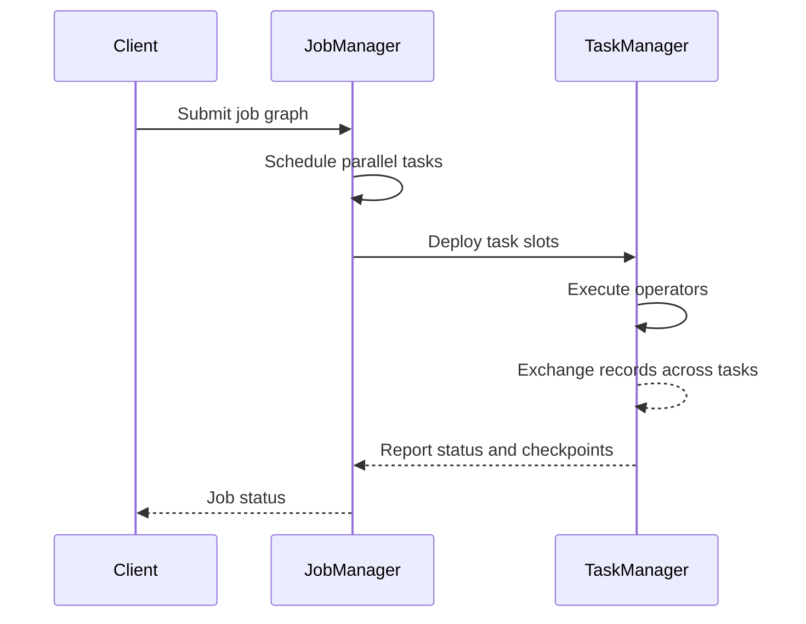

🗓️ 16012025 1129

# stream_processing_runtime

Flink separates job coordination from task execution: the JobManager coordinates a job, while TaskManagers run its tasks and exchange stream data.

## Main runtime roles

- **Client:** prepares and submits a dataflow. It can remain attached for progress updates or disconnect after submission.
- **JobManager:** coordinates scheduling, checkpoints, and recovery. A JobManager hosts components including a Dispatcher, ResourceManager, and a JobMaster for each job.
- **TaskManager:** executes tasks and buffers data exchanged between them.
- **Task slot:** a TaskManager resource unit used for scheduling. Slot sharing can place multiple subtasks from the same job in one slot; slots do not provide CPU isolation.

Flink can run as a standalone cluster or use a resource manager such as Kubernetes or YARN. A **session cluster** accepts multiple submitted jobs; an **application deployment** ties the cluster lifecycle more closely to one application. Deployment mode affects startup time, isolation, and resource ownership.

## Execution layout

Flink can chain adjacent operators into a task to reduce handoffs and buffering. Parallelism controls how many subtasks execute for an operator. Slot needs depend on scheduling and slot sharing; do not infer total slot requirements by summing every operator's parallelism.

For dataflow concepts, see [[stream_processing_fundamentals]]. For coordinated recovery snapshots, see [[checkpointing]]. For state distribution across subtasks, see [[keyed_state]].

## References

- [Apache Flink: Architecture](https://nightlies.apache.org/flink/flink-docs-stable/docs/concepts/flink-architecture/)
- [Apache Flink: Jobs and scheduling](https://nightlies.apache.org/flink/flink-docs-stable/docs/internals/job_scheduling/)
