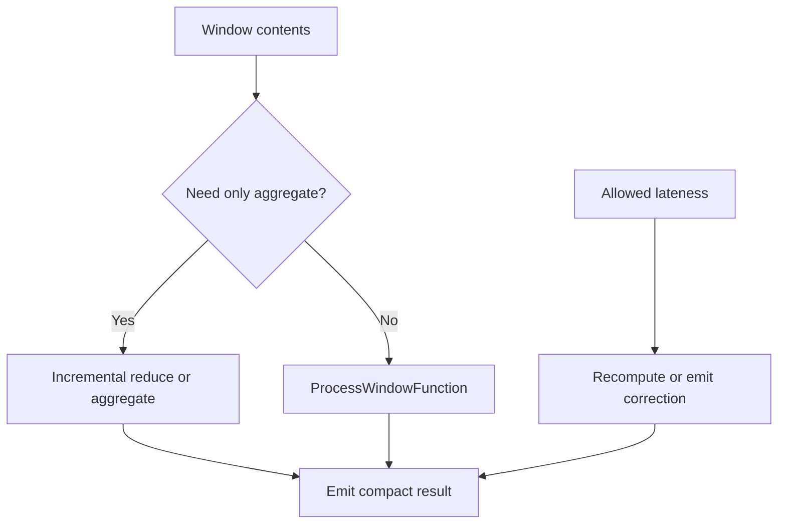

🗓️ 17012025 0116

# window_functions



## Options

| Option      | Description                                                                                             |
| ----------- | ------------------------------------------------------------------------------------------------------- |
| Batch       | Use `ProcessWindowFunction` to process all window events together                                       |
| Incremental | Using `ReduceFunction` or an `AggregateFunction` that is called as each event is assigned to the window |
| Hybrid      | Combine incremental results with `ProcessWindowFunction` for final processing                           |

## ProcessWindowFunction Example

- All of the events assigned to the window have to be buffered in keyed Flink state until the window is triggered > This is potentially quite expensive.
```java
DataStream<SensorReading> input = ...;

input
    .keyBy(x -> x.key)
    .window(TumblingEventTimeWindows.of(Time.minutes(1)))
    .process(new MyWastefulMax());

public static class MyWastefulMax extends ProcessWindowFunction<
        SensorReading,                  // input type
        Tuple3<String, Long, Integer>,  // output type
        String,                         // key type
        TimeWindow> {                   // window type
    
    @Override
    public void process(
            String key,
            Context context, 
            Iterable<SensorReading> events,
            Collector<Tuple3<String, Long, Integer>> out) {

        int max = 0;
        for (SensorReading event : events) {
            max = Math.max(event.value, max);
        }
        out.collect(Tuple3.of(key, context.window().getEnd(), max));
    }
}
```

```java
public abstract class Context implements java.io.Serializable {
    public abstract W window();
    
    public abstract long currentProcessingTime();
    public abstract long currentWatermark();

    public abstract KeyedStateStore windowState();
    public abstract KeyedStateStore globalState();
}
```

```ad-note
- `windowState` and `globalState` are places where you can store per-key, per-window, or global per-key information for all windows of that key
- useful for getting information from current window when processing a subsequent window
```

## Incremental Aggregation Example

```java
DataStream<SensorReading> input = ...;

input
    .keyBy(x -> x.key)
    .window(TumblingEventTimeWindows.of(Time.minutes(1)))
    .reduce(new MyReducingMax(), new MyWindowFunction());

private static class MyReducingMax implements ReduceFunction<SensorReading> {
    public SensorReading reduce(SensorReading r1, SensorReading r2) {
        return r1.value() > r2.value() ? r1 : r2;
    }
}

private static class MyWindowFunction extends ProcessWindowFunction<
    SensorReading, Tuple3<String, Long, SensorReading>, String, TimeWindow> {

    @Override
    public void process(
            String key,
            Context context,
            Iterable<SensorReading> maxReading,
            Collector<Tuple3<String, Long, SensorReading>> out) {

        SensorReading max = maxReading.iterator().next();
        out.collect(Tuple3.of(key, context.window().getEnd(), max));
    }
}
```

```ad-note
`Iterable<SensorReading>` will contain exactly one reading – the pre-aggregated maximum computed by `MyReducingMax`

```

## Controlling Late Events
```ad-abstract
Events are dropped by default when using event time windows
```

1. Arrange for the events that would be dropped to be collected to an alternate output stream instead, using  [[side_outputs]]
2. You can also specify an interval of _allowed lateness_ during which the late events will continue to be assigned to the appropriate window(s) (whose state will have been retained)
> By default each late event will cause the window function to be called again (sometimes called a _late firing_).

```java
stream
    .keyBy(...)
    .window(...)
    .allowedLateness(Time.seconds(10))
    .process(...);
```

```ad-note
When the allowed lateness is greater than zero, only those events that are so late that they would be dropped are sent to the side output (if it has been configured)
```

---

## References
- https://nightlies.apache.org/flink/flink-docs-release-1.20/docs/learn-flink/streaming_analytics/
