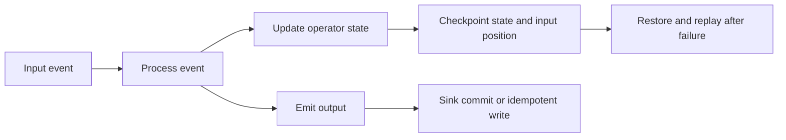

🗓️ 15012025 1021

# stream_processing_semantics
- Refer to the **guarantees** a stream processing system provides regarding the processing of events in a data stream
- Define how the system behaves during:
	- Normal conditions
	- During failures, ensuring data is processed correctly

## Types

| **Semantics**     | **Description**                                                                                      | **Use Case**                                                                                          |
| ----------------- | ---------------------------------------------------------------------------------------------------- | ----------------------------------------------------------------------------------------------------- |
| **At-Most-Once**  | Events are processed at most once. If a failure occurs, some events may be lost.                     | Low-latency systems where occasional data loss is acceptable (e.g., real-time monitoring dashboards). |
| **At-Least-Once** | Events are processed at least once. Duplicates may occur if a failure happens.                       | Applications where occasional duplication is acceptable (e.g., logging systems).                      |
| **Exactly-Once**  | Events are processed exactly once, ensuring no data is lost or duplicated, even in case of failures. | Critical systems like payment processing, billing, or fraud detection.                                |

---

## References
- [Apache Flink: Fault tolerance](https://nightlies.apache.org/flink/flink-docs-stable/docs/learn-flink/fault_tolerance/)
