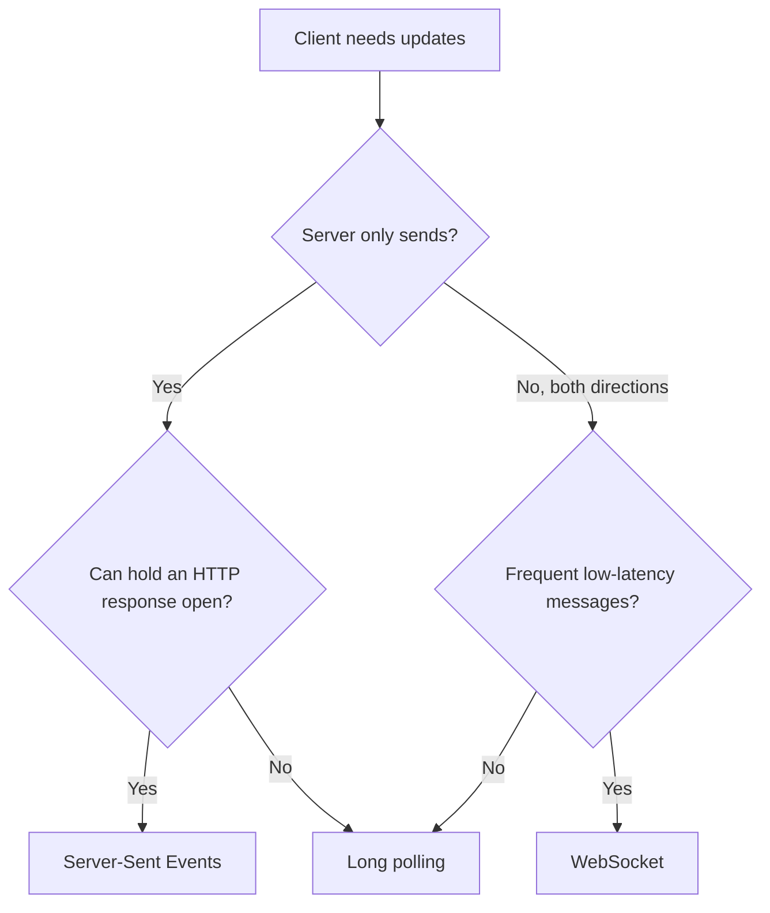

🗓️ 06062026 1500

# realtime_patterns_comparison

> Four ways to push data to clients. Choose the simplest option that meets your needs.

## At a Glance

|                     | Short Polling                   | [[long_polling]]                    | [[server_sent_events]]                  | [[websocket_protocol]]                  |
| ------------------- | ------------------------------- | ----------------------------------- | --------------------------------------- | --------------------------------------- |
| **Direction**       | Client -> Server                 | Client -> Server (held)              | Server -> Client                         | Bidirectional                           |
| **Connection**      | New per request                 | Held, reconnect after each response | Persistent stream                       | Persistent socket                       |
| **Latency**         | Poll interval (1–30s)           | Near-real-time                      | Real-time                               | Real-time                               |
| **Protocol**        | HTTP                            | HTTP                                | HTTP (`text/event-stream`)              | `ws://` / `wss://` (upgraded from HTTP) |
| **Binary support**  | Via response body               | Via response body                   | Text only (Base64 for binary)           | Native binary frames                    |
| **Auto-reconnect**  | N/A (client polls)              | Client must implement               | Built-in (`EventSource`)                | Must implement                          |
| **Browser support** | Universal                       | Universal                           | All modern (no IE)                      | All modern (no IE)                      |
| **Proxy friendly**  | Yes                             | Mostly (idle timeouts)              | Yes (standard HTTP)                     | Varies (upgrade may be blocked)         |
| **Max connections** | N/A (short-lived)               | 6/domain (HTTP/1.1)                 | 6/domain (HTTP/1.1), unlimited (HTTP/2) | 6/domain (HTTP/1.1)                     |
| **Server cost**     | Low per-request, high aggregate | 1 held conn/client                  | 1 persistent conn/client                | 1 persistent socket/client              |

## Decision Guide

- Need bidirectional messaging? Use websocket protocol.
- Need one-way, high-frequency updates? Use server sent events. Use websocket protocol if you need binary data.
- Need to work through restrictive proxies or firewalls? Use long polling, with short polling as a fallback.
- Need simple, low-frequency updates? Use server sent events for updates every few seconds, or short polling with `ETag`/`304` for updates every 30 seconds or more.

## Common Combinations

**SSE + POST.** Most web apps have asymmetric traffic: many server-to-client updates and occasional client-to-server actions. Use server sent events for updates and regular `POST`/`PUT` requests for client actions. This is simpler than websocket protocol, works through standard proxies, and keeps each concern separate.

**WebSocket + HTTP fallback.** Socket.IO popularized this: try websocket protocol, then fall back to long polling if the upgrade fails. Useful when clients are behind unpredictable corporate proxies.

**Short Polling for status checks.** Job progress, deploy status, CI builds — poll every 5–10s with `ETag`/`If-None-Match`. Server returns `304 Not Modified` when nothing changed (minimal bandwidth). Simple, stateless, cache-friendly. Don't overthink it.

## Scaling Considerations

All persistent-connection approaches (long polling, server sent events, and websocket protocol) share the same fundamental challenge: **one connection per client**. At scale:

- **Thread-per-request servers** (classic Tomcat, PHP) don't work. Need non-blocking I/O (Netty, Node.js, Go, Spring WebFlux).
- **Load balancers** need connection-aware routing. websocket protocol and long polling need sticky sessions or a pub/sub backbone. server sent events can reconnect to another backend, but replay still requires shared event history.
- **File descriptors.** Each connection = 1 fd. Default OS limits (~1024) hit fast. Tune `ulimit -n` for production.
- **Memory.** Each connection carries state (buffers, metadata). Profile per-connection overhead and multiply by expected concurrency.

## Bridges to Other Domains

- [[load_balancer]] — sticky sessions for stateful connections, health checks for WebSocket backends.
- [[gateway_patterns]] — must understand `Upgrade` headers to proxy WebSocket. Most modern gateways (NGINX, Kong, Envoy) do.
- transports — MCP Streamable HTTP uses HTTP POST with optional SSE responses. Real-world example of combining request/response with streaming.
- [[circuit_breaker_pattern]] — upstream circuit breakers for WebSocket reconnection storms.

---

## References

- [RFC 6455 — WebSocket Protocol](https://datatracker.ietf.org/doc/html/rfc6455)
- [RFC 6202 — Long Polling Best Practices](https://datatracker.ietf.org/doc/html/rfc6202)
- [WHATWG — Server-Sent Events](https://html.spec.whatwg.org/multipage/server-sent-events.html)
