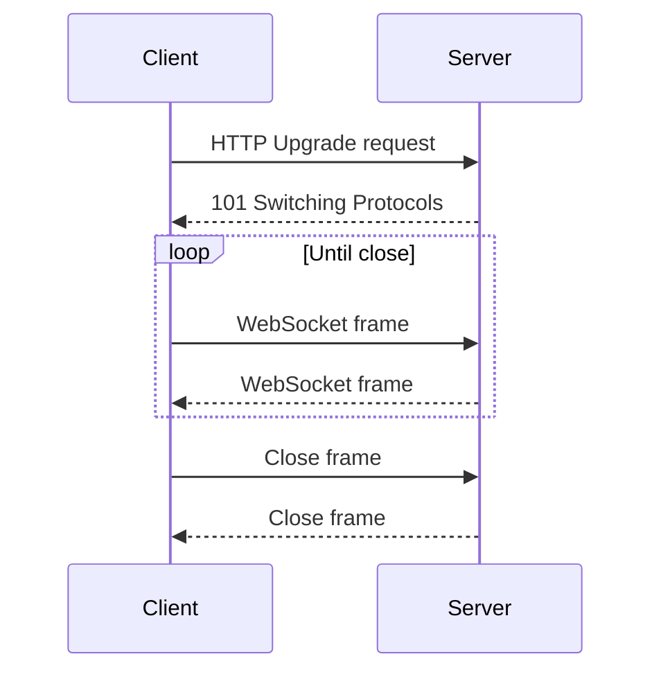

🗓️ 06062026 1500

# websocket_protocol

The WebSocket protocol provides two-way communication over a TCP connection. Its RFC 6455 opening handshake uses HTTP/1.1, then the peers exchange framed messages without a new HTTP request for each message. Compare [[realtime_patterns_comparison]] when choosing a client update protocol.

## Terms

| Term | Definition | Source |
|---|---|---|
| **WebSocket protocol** | A protocol for two-way communication between a client and server, using an opening handshake followed by framed messages over TCP. | [RFC 6455](https://datatracker.ietf.org/doc/html/rfc6455) |

## The Upgrade Handshake

The HTTP/1.1 handshake asks the server to upgrade the connection. After the server accepts, both peers send frames over the established connection.



`Sec-WebSocket-Key` is a random Base64 nonce. Server concatenates it with a magic GUID, SHA-1 hashes, Base64-encodes → `Sec-WebSocket-Accept`. This proves the server understands WebSocket, not just any HTTP server reflecting headers.

## Frame Types

After upgrade, communication is via **frames**, not HTTP requests:

| Opcode | Type | Purpose |
|--------|------|---------|
| `0x1` | Text | UTF-8 text message |
| `0x2` | Binary | Raw bytes (images, protobuf, etc.) |
| `0x8` | Close | Initiate graceful shutdown (status code + reason) |
| `0x9` | Ping | Heartbeat probe (server or client) |
| `0xA` | Pong | Response to ping |

Messages can be **fragmented** across multiple frames for streaming large payloads without buffering the whole thing in memory.

Client-to-server frames are masked with a fresh four-byte key; server-to-client frames are not. Masking prevents attacker-controlled browser data from appearing as chosen bytes on the wire to vulnerable intermediaries. It does not encrypt the connection; use `wss://` for transport confidentiality and integrity.

## Connection Lifecycle

**Ping/pong** keeps the connection alive through idle-timeout proxies and detects dead peers. Either side can send a ping; the other must respond with a pong containing the same payload.

## Subprotocols

The `Sec-WebSocket-Protocol` header negotiates an application-level protocol on top of WebSocket:

```
Client: Sec-WebSocket-Protocol: graphql-ws, json
Server: Sec-WebSocket-Protocol: graphql-ws
```

Common subprotocols: `graphql-ws`, `wamp`, `stomp`, `mqtt`. The WebSocket spec defines the framing; the subprotocol defines message semantics.

## Browser API

```javascript
const ws = new WebSocket('wss://example.com/ws');

ws.onopen = () => ws.send(JSON.stringify({ type: 'subscribe', channel: 'prices' }));
ws.onmessage = (e) => console.log(JSON.parse(e.data));
ws.onclose = (e) => console.log(`closed: ${e.code} ${e.reason}`);
ws.onerror = (e) => console.error('ws error', e);
```

The browser API does not automatically reconnect. The application must define retry, backoff, and subscription recovery. [[server_sent_events]] is simpler when only server-to-client updates are needed; [[long_polling]] can serve as a fallback where WebSocket is unavailable.

## When to Use

- **Bidirectional streaming.** Chat, multiplayer games, collaborative editing, trading terminals.
- **Low-latency.** No HTTP overhead per message after the handshake. One TCP connection, minimal framing.
- **Binary data.** Native binary frames — protobuf, MessagePack, images — no Base64 encoding tax.
- **High-frequency messages.** Sub-100ms intervals where HTTP request overhead matters.

## Common Pitfalls

```ad-warning
**Load balancer configuration.** Each open connection stays attached to one backend. After reconnect, the client may reach another backend; keep session state in shared storage or route messages through shared pub/sub when any backend must serve the client. Sticky routing is an option when the application depends on local session state.

See [[load_balancer]] for how routing affects backend selection.
```

- **Proxy/firewall issues.** Proxies and firewalls must allow the handshake and long-lived connection. TLS protects `wss://` traffic in transit but does not guarantee that a network permits it.
- **No HTTP response caching.** WebSocket messages are not HTTP responses, so validators such as `ETag` do not apply. Compression requires a negotiated extension such as `permessage-deflate` and trades bandwidth for CPU and memory.
- **Resource exhaustion.** Each connection is a persistent socket. 100k concurrent users = 100k sockets. Monitor `file descriptor` limits, tune OS `ulimit`, and use non-blocking I/O.
- **Security.** `Origin` header validation is critical — WebSocket doesn't enforce same-origin policy. Without it, any page can open a connection to your server.

## Server Frameworks

| Language | Library/Framework |
|---|---|
| Java | Spring WebSocket (`@ServerEndpoint`), Netty |
| Node.js | `ws`, Socket.IO (adds fallback + rooms) |
| Go | `gorilla/websocket`, `nhooyr.io/websocket` |
| Python | `websockets`, FastAPI WebSocket |

---

## References

- [RFC 6455 — The WebSocket Protocol](https://datatracker.ietf.org/doc/html/rfc6455)
- [MDN: WebSocket API](https://developer.mozilla.org/en-US/docs/Web/API/WebSocket)
- [MDN: Writing WebSocket servers](https://developer.mozilla.org/en-US/docs/Web/API/WebSockets_API/Writing_WebSocket_servers)
