🗓️ 11102026 1200

# mermaid

Every diagram type bundled with mermaid 11.15, rendered with the Rosé Pine Moon theme.

## Flowchart

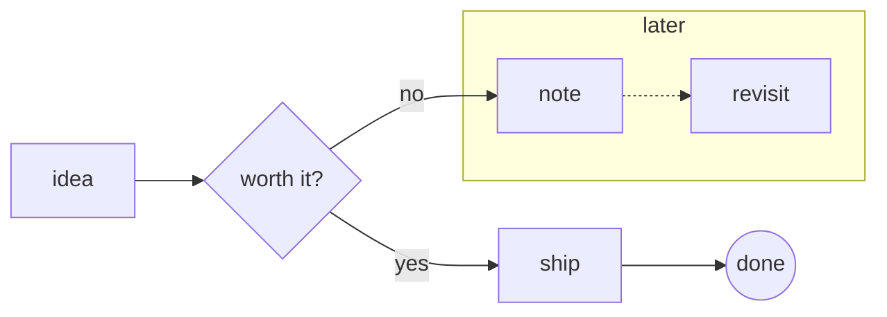

## Sequence

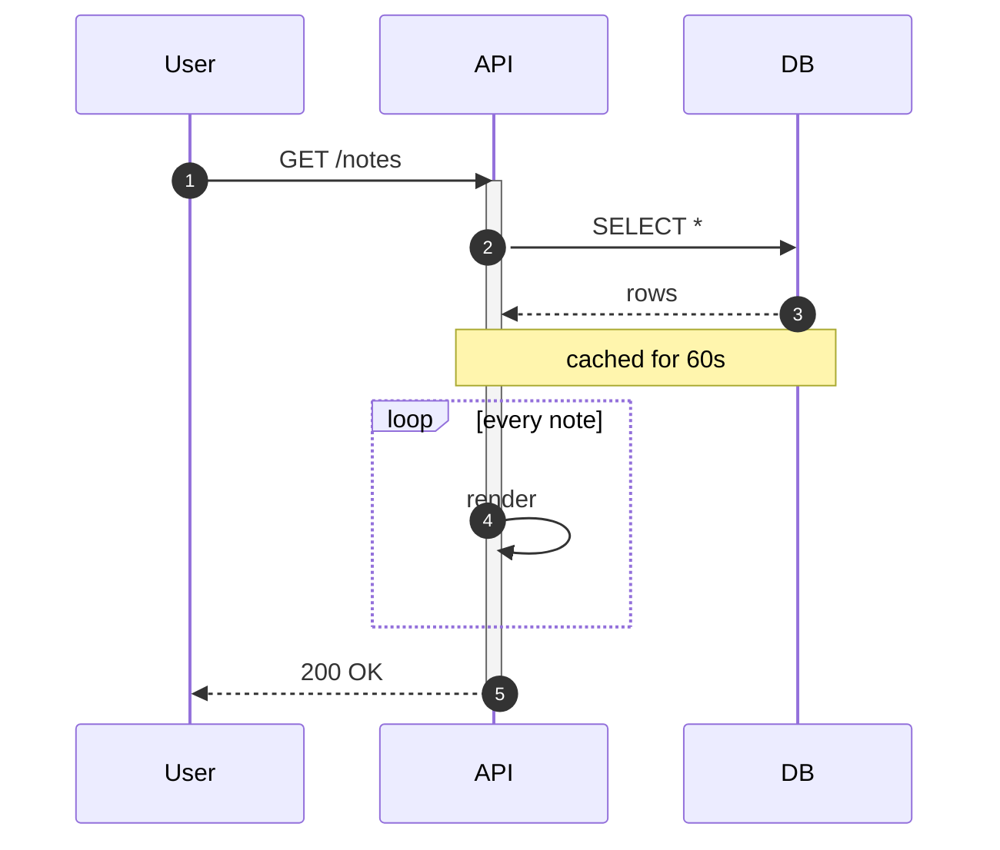

## Class

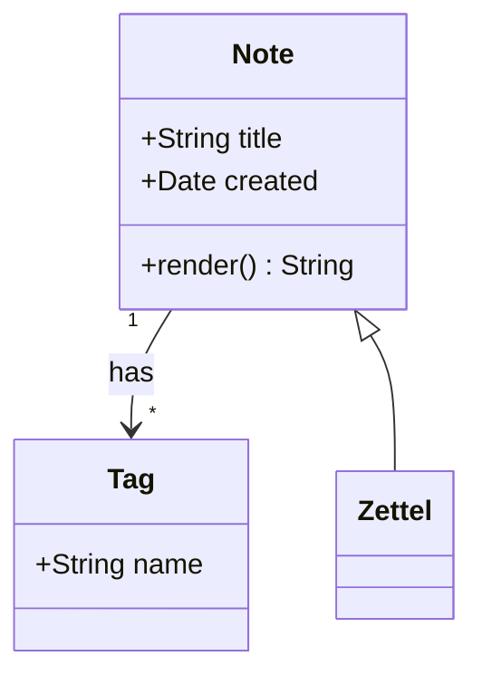

## State

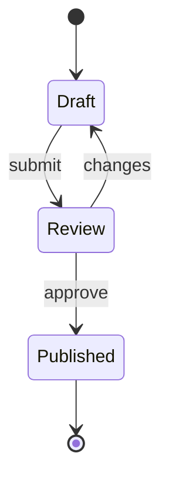

## Entity relationship

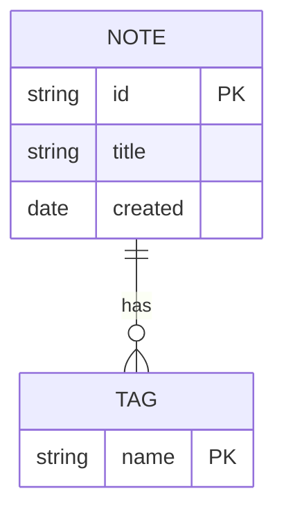

## User journey

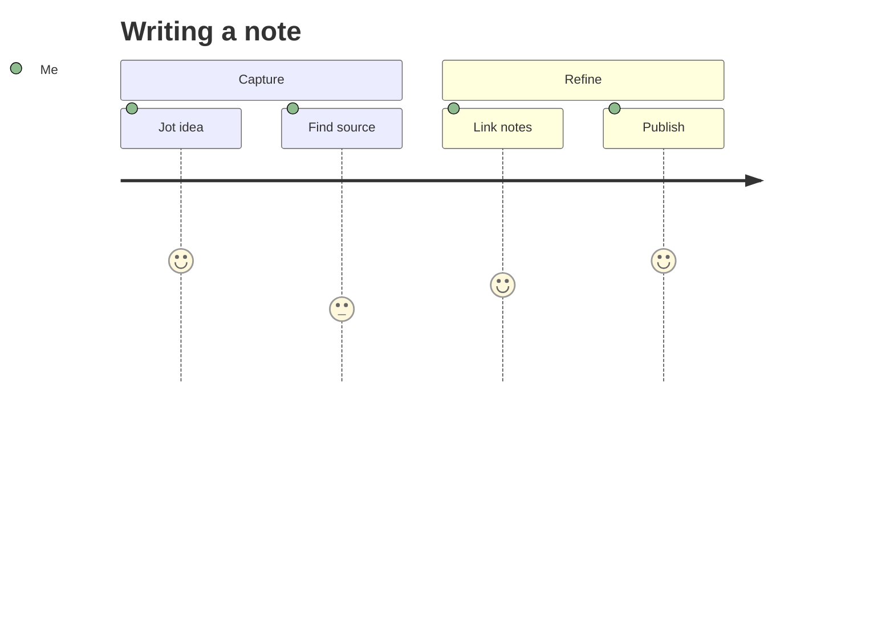

## Gantt

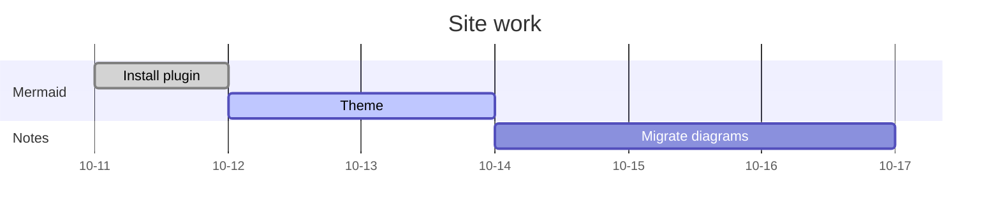

## Pie

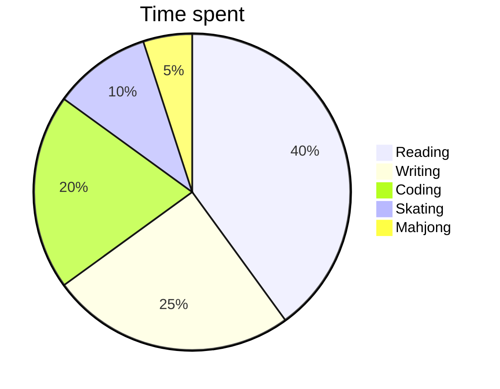

## Quadrant chart

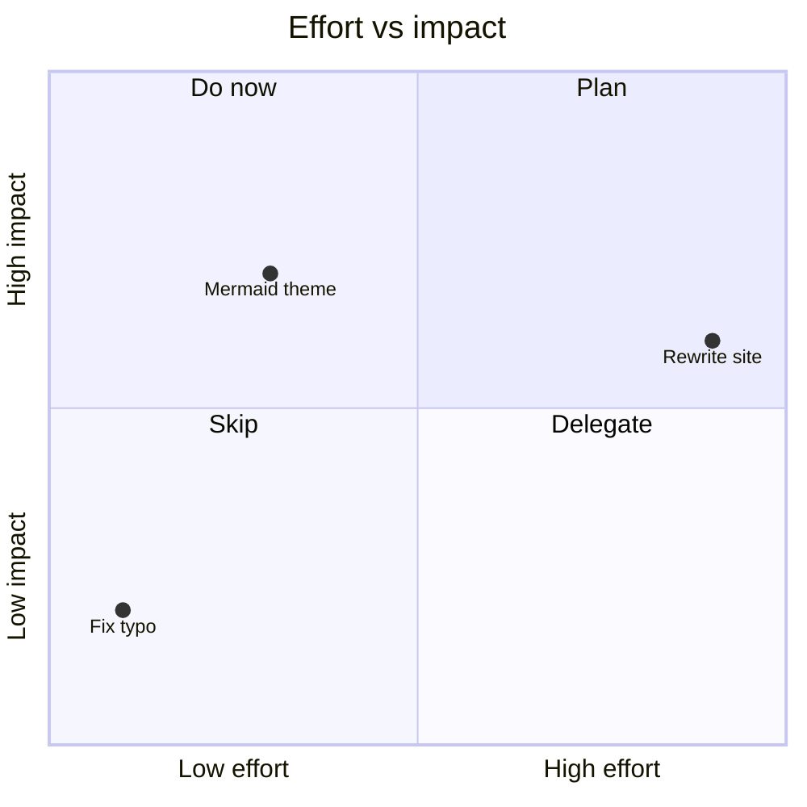

## Requirement

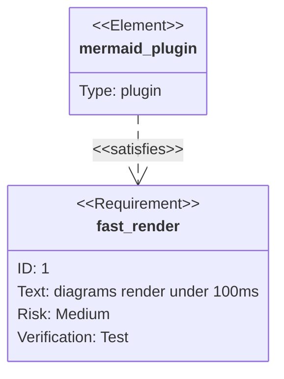

## Git graph

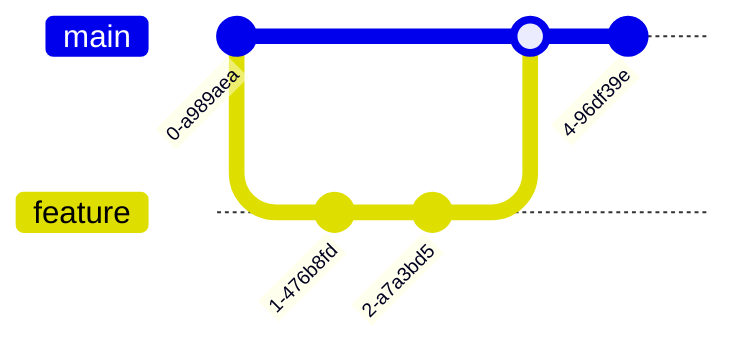

## C4

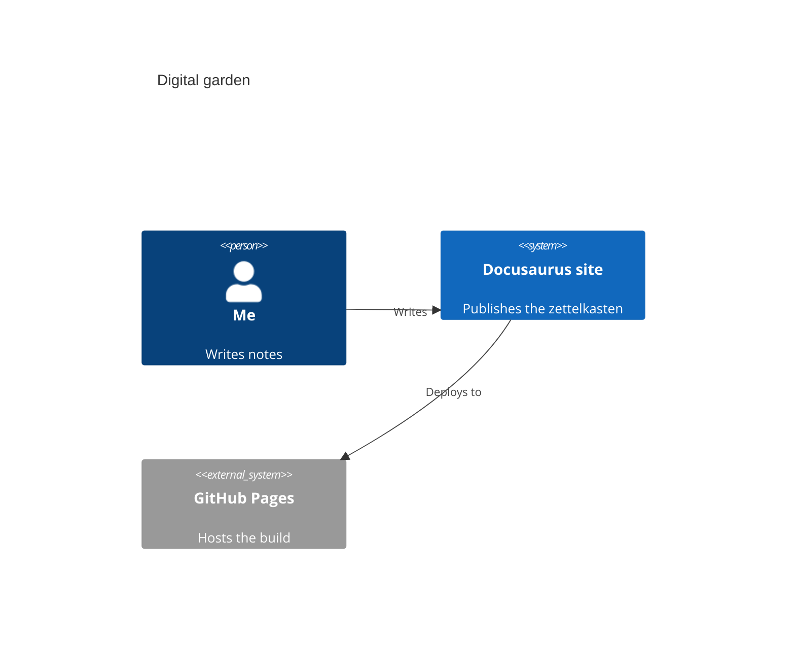

## Mindmap

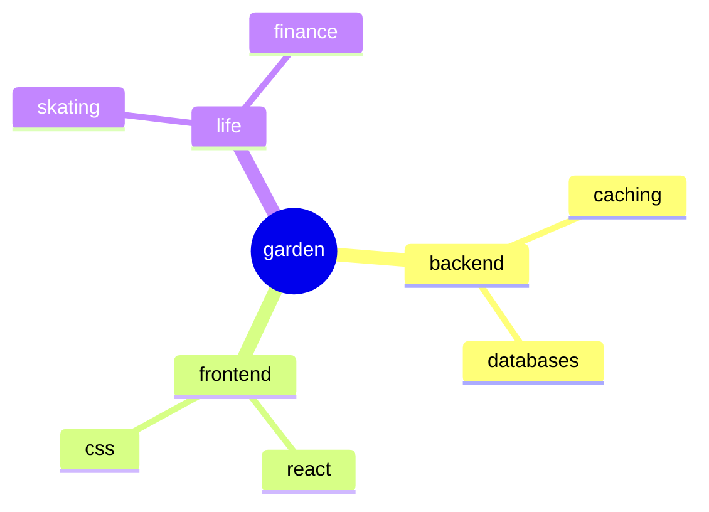

## Timeline

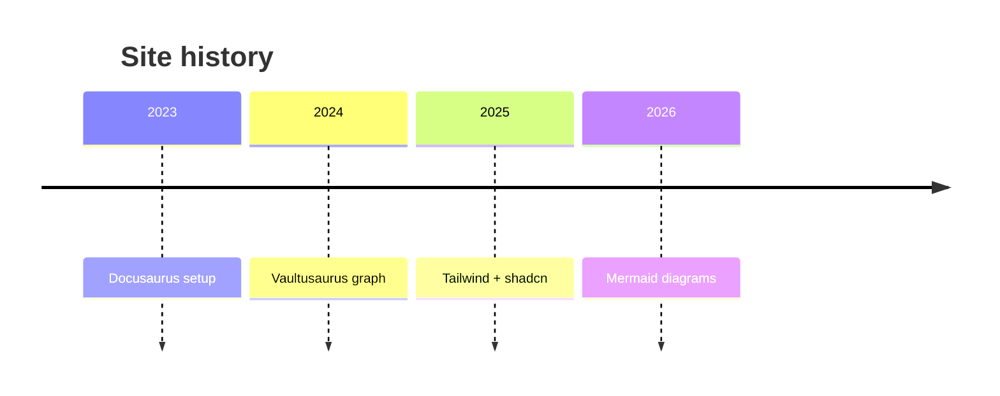

## Sankey

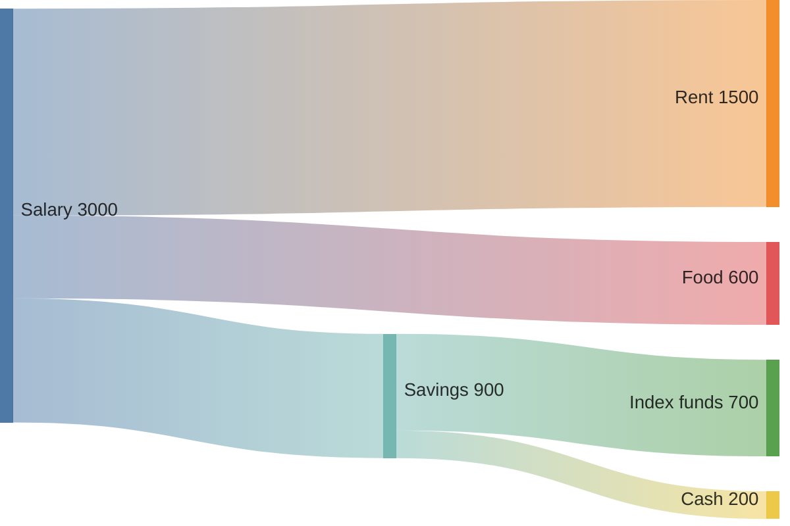

## XY chart

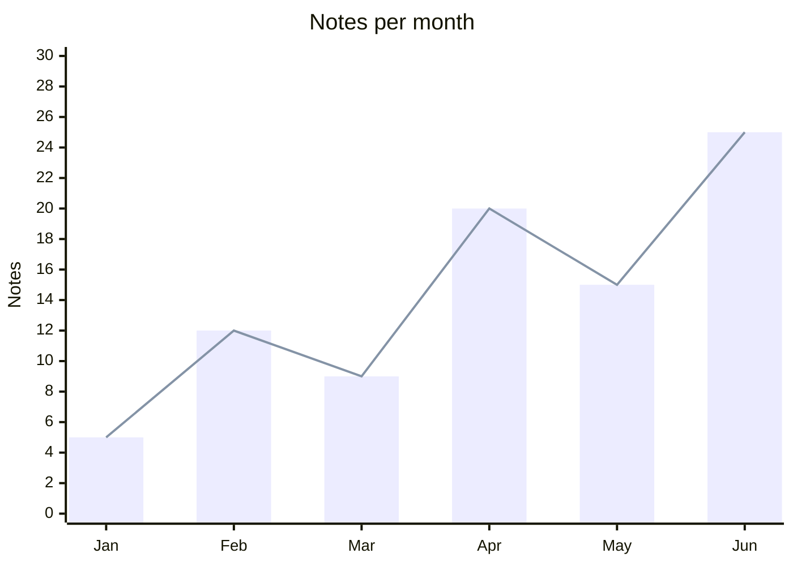

## Block

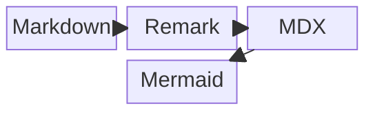

## Packet

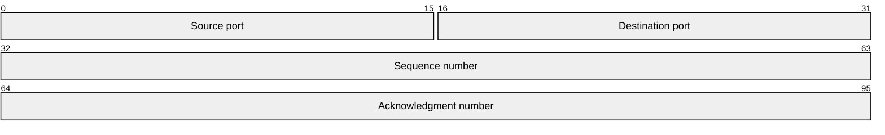

## Kanban

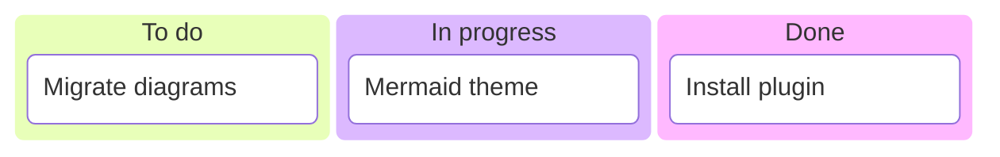

## Architecture

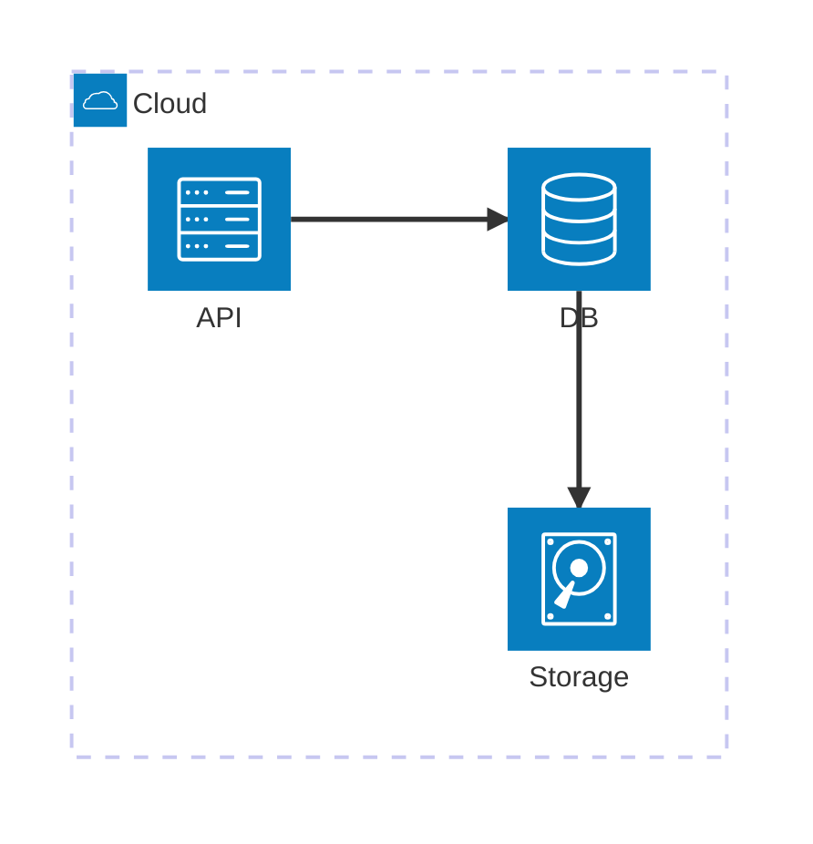

## Radar

```mermaid
radar-beta
  title Skills
  axis fe["Frontend"], be["Backend"], ops["Infra"], ds["Data"], ux["Design"]
  curve now["Now"]{4, 3, 2, 2, 3}
  curve goal["Goal"]{4, 4, 4, 3, 4}
  max 5
```

## Treemap

```mermaid
treemap-beta
"Notes"
  "Backend"
    "Caching": 12
    "Databases": 8
  "Frontend"
    "React": 10
    "CSS": 6
```

## Tree view

```mermaid
treeView-beta
    "www"
        "docs"
            "zettelkasten"
        "src"
            "css"
            "pages"
        "docusaurus.config.ts"
```

## Ishikawa

```mermaid
ishikawa-beta
    Slow build
    Code
        Large bundles
        Unused deps
    Tooling
        Cold cache
    Content
        Many notes
        Big images
```

## Venn

```mermaid
venn-beta
  title What makes a good note
  set Atomic
  set Linked
  set Sourced
  union Atomic,Linked["Navigable"]
  union Linked,Sourced["Trustworthy"]
  union Atomic,Sourced["Citable"]
  union Atomic,Linked,Sourced["Evergreen"]
```

## Wardley map

```mermaid
wardley-beta
title Tea Shop Value Chain

anchor Business [0.95, 0.63]
component Cup of Tea [0.79, 0.61]
component Tea [0.63, 0.81]
component Hot Water [0.52, 0.80]
component Kettle [0.43, 0.35]
component Power [0.10, 0.70]

Business -> Cup of Tea
Cup of Tea -> Tea
Cup of Tea -> Hot Water
Hot Water -> Kettle
Kettle -> Power

evolve Kettle 0.62
evolve Power 0.89
```

## Event modeling

```mermaid
eventmodeling

tf 01 ui CartUI
tf 02 cmd AddItem
tf 03 evt ItemAdded
```

---
## References
- https://mermaid.js.org/intro/
