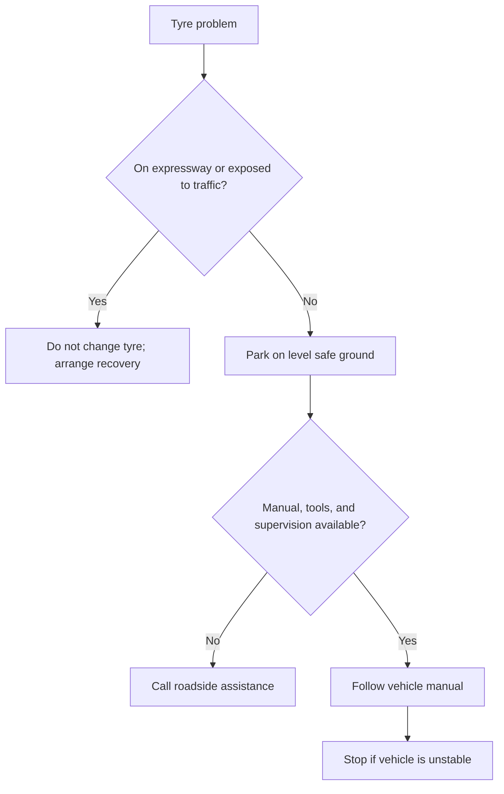

🗓️ 21102026 1546

# car_basics

Basic car care is knowing the vehicle, checking simple items, and staying safe when it fails.

## Terms

| Term | Definition | Source |
|---|---|---|
| **Tyre-pressure placard** | A vehicle label showing manufacturer-recommended tyre pressure and related tyre information. | [Goodyear](https://www.goodyear.com/en-us/learn/tire-air-pressure) |

## Learn the specific vehicle

Read its owner's manual with the owner. Locate the tyre-pressure placard, warning-light guide, spare tyre or repair kit, jack, and roadside-assistance details. Tyre pressure and jacking points are vehicle-specific; follow the placard and manual.

Check tyre pressure when tyres are cold, using the vehicle placard or manual. Learn the warning lights and how to check washer fluid and engine oil without guessing.

## Tyre change practice

Practise only with the owner's permission, on level ground, away from traffic, and using the vehicle's stated lifting points. Ask an experienced person to supervise. If the car is unstable, the tools are missing, or the wheel will not release safely, stop and call roadside assistance.

## Expressway breakdowns in Singapore

Switch on hazard lights and move off the carriageway if possible. Do not step into the expressway. Keep passengers clear of traffic and behind the impact guardrail while waiting for recovery. Arrange towing promptly; the shoulder is hazardous.

---
## References

- [Singapore Police Force: Driving in Traffic](https://www.police.gov.sg/-/media/SPF/Advisories/TP/FT-ENG-2126.pdf)
- [LTA: Driving on Expressways and in Tunnels](https://onemotoring.lta.gov.sg/content/onemotoring/home/driving/road_safety_and_vehicle_rules/driving-in-expressway-and-tunnel.html)
- [Goodyear: Tire Air Pressure](https://www.goodyear.com/en-us/learn/tire-air-pressure)
