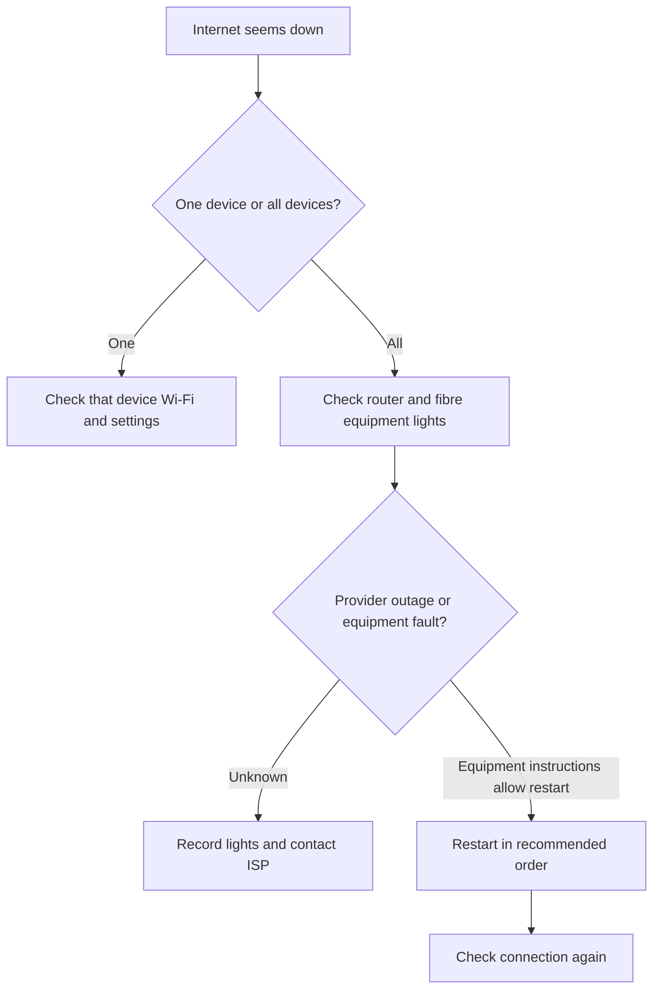

🗓️ 21102026 1546

# home_internet_troubleshooting

Troubleshooting is easier when you separate a device problem from a home-network or provider problem.

## Trace the connection

Start with one question: is one device affected, or are all devices offline? Check whether nearby devices can connect and whether the router or fibre equipment shows an unusual status light.

Identify the fibre termination point, modem or gateway, router, and any mesh nodes. Equipment can combine several roles; [[modem_vs_router]] explains the basic distinction.

Restart only as directed by the provider or device manual. Avoid a factory reset unless instructed, because it can erase network settings. When contacting support, report the time, status lights, affected devices, and any change after restarting.

---
## References

- [IMDA: What to do during a Digital Connectivity Disruption](https://www.imda.gov.sg/user-and-set-up-guides/mobile-and-broadband/what-to-do-during-a-digital-connectivity-disruption)
- [Cisco: What is a router?](https://www.cisco.com/c/en/us/solutions/small-business/resource-center/networking/what-is-a-router.html)
