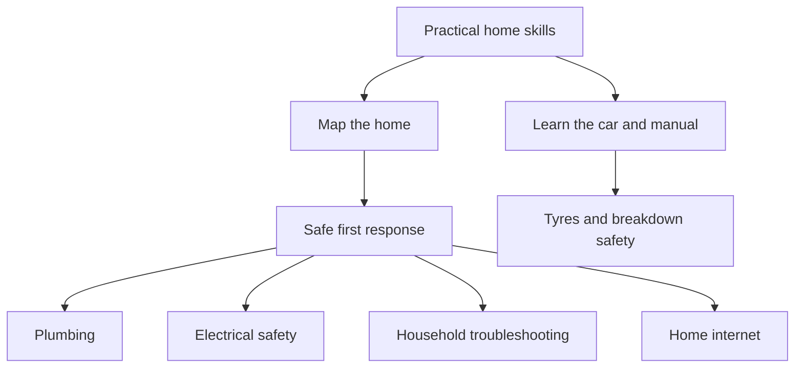

🗓️ 21102026 1546

# home

Practical notes for handling everyday home issues and basic vehicle care. Learn the system, make safe first checks, and recognise when qualified help is needed.

Start with [[household_systems_inventory]], then follow [[maintenance/index]] for plumbing, electrical safety, and troubleshooting. Learn the home network through [[home_internet_troubleshooting]] and [[modem_vs_router]]. For vehicle checks and breakdown safety, read [[car_basics]]. For room layout and finishes, see [[practical_interior_design]].

---
## References

- [PUB: Plumbing Works](https://www.pub.gov.sg/Professionals/Requirements/Licensed-Plumbers/Plumbing-Works)
- [EMA: Engaging Licensed Workers](https://www.ema.gov.sg/consumer-information/electricity/engaging-licensed-workers)
- [Singapore Police Force: Driving in Traffic](https://www.police.gov.sg/-/media/SPF/Advisories/TP/FT-ENG-2126.pdf)
