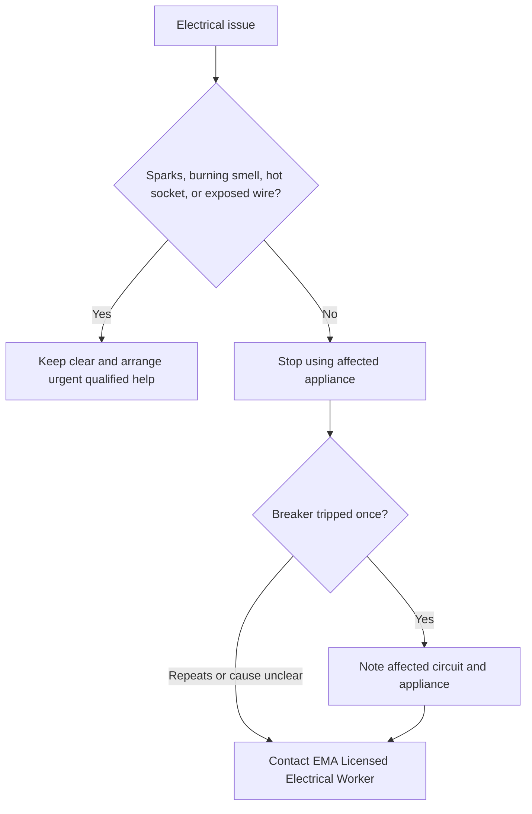

🗓️ 21102026 1546

# electrical_safety_at_home

Learn to recognise electrical problems and make a safe handoff. Electrical repair is not a beginner DIY task.

> **Electrical work**: Installation, repair, modification, or replacement of an electrical installation, including wiring, switches, sockets, and lighting points. ([EMA](https://www.ema.gov.sg/consumer-information/electricity/engaging-licensed-workers))

## Safe observations

Learn where the electrical distribution board is and what its labels mean. Do not open it or touch exposed wiring. Replacing a bulb is different from replacing a lighting point: switch off the light, let the fitting cool, and follow its instructions.

If a breaker trips, note what was running and whether the trip repeats. Do not keep resetting it without finding the cause.

In Singapore, installation, repair, modification, or replacement of switches, sockets, lighting points, wiring, and circuit breakers must be carried out or supervised by an EMA Licensed Electrical Worker. Learn the symptoms and handoff; do not practise that work yourself.

---
## References

- [EMA: Engaging Licensed Workers](https://www.ema.gov.sg/consumer-information/electricity/engaging-licensed-workers)
- [EMA: Electrical Safety](https://www.ema.gov.sg/consumer-information/electricity/electrical-safety)
