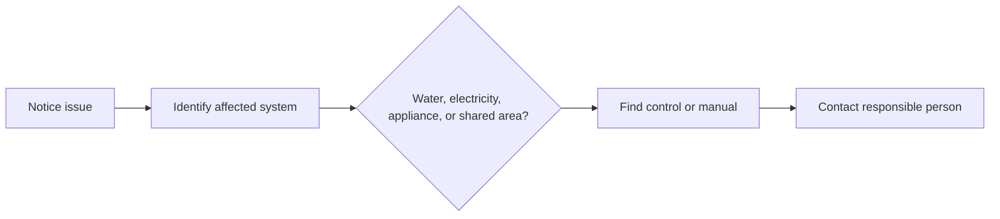

🗓️ 21102026 1546

# household_systems_inventory

A small home map helps you respond calmly when something stops working or leaks.

## Map the important points

With the homeowner or housemate, locate:

- The water meter and household shutoff.
- The electrical distribution board and breaker labels.
- Appliance manuals, warranty details, and service contacts.
- The landlord, Town Council, or managing agent contact.
- The building's process for reporting shared-area faults.

Do not operate an unfamiliar shutoff or breaker just to test it. Ask the responsible person to show what it controls and when it is safe to use.

Use this map before following [[plumbing_first_response]] or [[electrical_safety_at_home]].

---
## References

- [PUB: Help and Feedback](https://eservices.pub.gov.sg/helpandfeedback/report)
- [HDB: Professional Help and Contractors](https://www.hdb.gov.sg/managing-my-home/renovation-and-maintenance/home-maintenance/professional-help-and-contractors)
