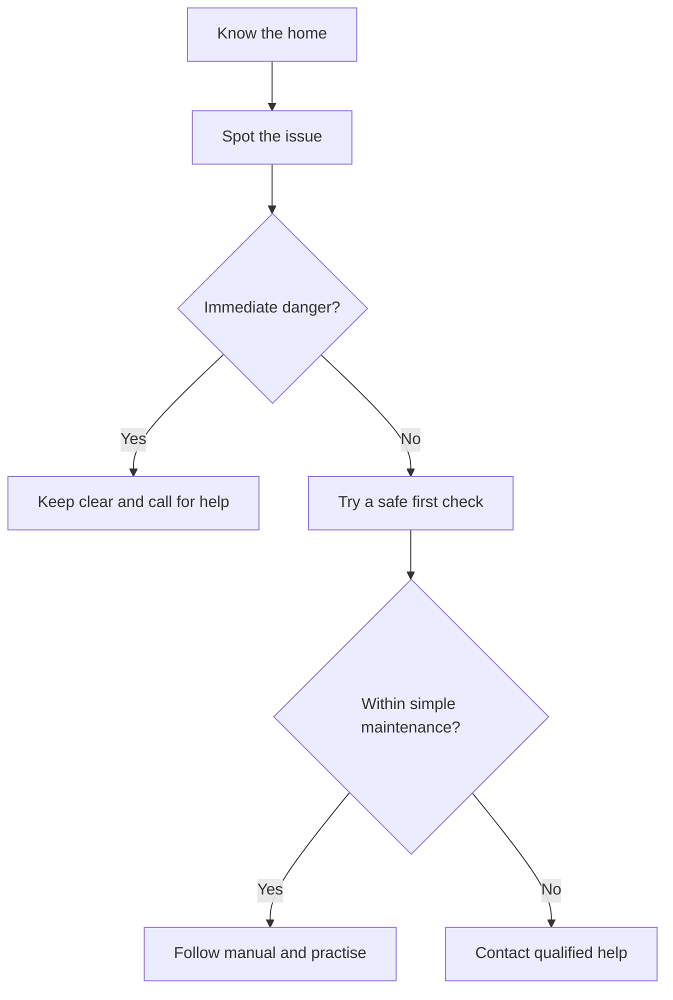

🗓️ 21102026 1546

# maintenance

Learn how to respond safely to common household issues. Begin by locating controls and contacts, then learn one system at a time.

Use [[household_systems_inventory]] to locate shutoffs, breakers, and service contacts. Learn the boundaries for [[plumbing_first_response]], [[electrical_safety_at_home]], and [[safe_household_troubleshooting]]. For connectivity, see [[home_internet_troubleshooting]].

---
## References

- [PUB: Plumbing Works](https://www.pub.gov.sg/Professionals/Requirements/Licensed-Plumbers/Plumbing-Works)
- [EMA: Engaging Licensed Workers](https://www.ema.gov.sg/consumer-information/electricity/engaging-licensed-workers)
