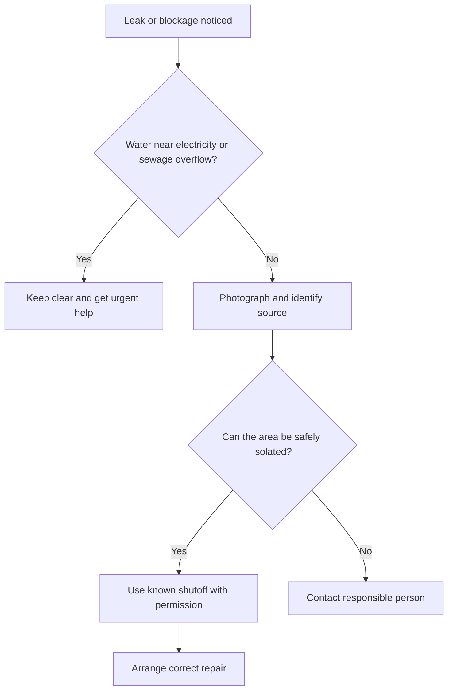

🗓️ 21102026 1546

# plumbing_first_response

First response means spotting the issue, limiting damage when safe, and knowing which work needs a professional.

## Terms

| Term | Definition | Source |
|---|---|---|
| **Water service plumbing work** | Work on pipes, tanks, taps, and fittings that carry supplied drinking water. | [PUB](https://www.pub.gov.sg/Professionals/Requirements/Licensed-Plumbers/Plumbing-Works) |
| **Sanitary plumbing work** | Work on appliances and pipes that carry used water to the sewerage system. | [PUB](https://www.pub.gov.sg/Professionals/Requirements/Licensed-Plumbers/Plumbing-Works) |
| **Licensed Plumber (LP)** | A plumber licensed by PUB for regulated water-service and sanitary plumbing work. | [PUB](https://www.pub.gov.sg/Professionals/Requirements/Licensed-Plumbers/Plumbing-Works) |

## First response

Look for dripping, wet patches, water that continues running, slow drainage, or toilet-bowl ripples. Photograph the issue and note when it began.

If there may be a leak, turn off water fittings and check whether the water meter continues moving. Only operate a shutoff after someone has shown you which valve serves the affected area.

## Work boundaries in Singapore

PUB allows handymen to do listed simple jobs, including certain tap and hose replacements and some blockage clearing. Regulated water-service and sanitary plumbing work must be done by a PUB Licensed Plumber. Check PUB's current list before engaging someone; the exact job matters.

Escalate active or hidden leaks, repeated blockages, sewage odours or backflow, and water near electrical equipment. Contact the landlord or building manager for flat-specific or shared systems; report major public pipe bursts to PUB.

---
## References

- [PUB: Plumbing Works](https://www.pub.gov.sg/Professionals/Requirements/Licensed-Plumbers/Plumbing-Works)
- [PUB: Help and Feedback](https://eservices.pub.gov.sg/helpandfeedback/report)
