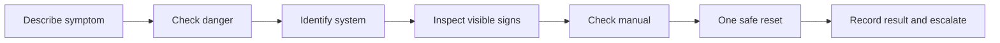

🗓️ 21102026 1546

# safe_household_troubleshooting

A repeatable check sequence turns a vague fault into useful evidence for the next person.

## Check in order

Describe what changed and when. Check for immediate danger before touching anything. Identify whether the issue involves power, water, an appliance, or a shared building system.

If safe, inspect visible connections and consult the manual. Try one manufacturer-recommended reset, then record what changed. Repeated resets can hide a fault; stop if the issue returns.

Low-risk practice includes tightening a loose cabinet handle, replacing remote batteries, and cleaning an appliance filter. Check the product instructions and get permission before working on someone else's property.

If the issue involves electricity, hidden plumbing, repeated faults, smoke, or a burning smell, stop and use [[electrical_safety_at_home]] or [[plumbing_first_response]] to find the right handoff.

---
## References

- [EMA: Electrical Safety](https://www.ema.gov.sg/consumer-information/electricity/electrical-safety)
- [PUB: Plumbing Works](https://www.pub.gov.sg/Professionals/Requirements/Licensed-Plumbers/Plumbing-Works)
