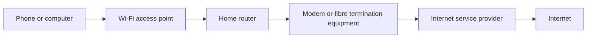

🗓️ 21102026 1546

# modem_vs_router

A home internet connection has two jobs: reach the provider and move traffic between devices and networks. One box may do both jobs.

## Terms

| Term | Definition | Source |
|---|---|---|
| **Modem** | A device that connects a network to an internet service provider's access network by converting signals for that connection. | [Cisco](https://www.cisco.com/c/en/us/solutions/small-business/resource-center/networking/what-is-a-router.html) |
| **Router** | A device that forwards data between networks, such as a home network and the internet. | [Cisco](https://www.cisco.com/c/en/us/solutions/small-business/resource-center/networking/what-is-a-router.html) |
| **Gateway** | A device that combines network functions, commonly including routing and provider access equipment. | [Cisco](https://www.cisco.com/c/en/us/solutions/small-business/resource-center/networking/what-is-a-router.html) |

## How the connection fits together

A device sends traffic over Wi-Fi or Ethernet to the home router. The router forwards it towards the provider through the modem or fibre termination equipment. Replies travel back along that path.

Many consumer devices combine router and Wi-Fi functions. Some also combine provider access equipment. Fibre installations may use an optical termination unit rather than a traditional cable or DSL modem, so follow the provider's labels and instructions.

The distinction helps narrow faults. If one device cannot connect, check that device first. If all devices are offline, inspect the router and provider equipment, then contact the Internet Service Provider if the fault persists. See [[home_internet_troubleshooting]].

---
## References

- [Cisco: What is a router?](https://www.cisco.com/c/en/us/solutions/small-business/resource-center/networking/what-is-a-router.html)
- [IMDA: What to do during a Digital Connectivity Disruption](https://www.imda.gov.sg/user-and-set-up-guides/mobile-and-broadband/what-to-do-during-a-digital-connectivity-disruption)
