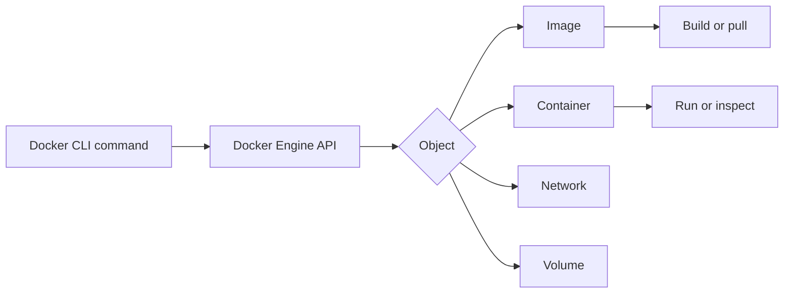

🗓️ 28032026 1600

# commands

> **Docker CLI**: The command-line interface used to interact with the Docker Engine API. ([Docker Docs](https://docs.docker.com/reference/cli/docker/))

The Docker CLI provides consistent operations for building and managing images, containers, volumes, and networks.

## Overview
- CLI interface for managing [[image]]s, [[container]]s, [[volumes]], and [[container_networking]]
- Commands follow pattern: `docker <object> <verb>` (e.g. `docker container ls`)

## Problem addressed
- Need a consistent way to build, run, inspect, and clean up Docker resources
- Legacy syntax (`docker run`, `docker ps`) mixes concerns; management commands (`docker container run`) group by resource type for clarity

## Legacy vs Management Commands

- **Legacy**: `docker run`, `docker ps`, `docker rm` - still works, widely used
- **Management**: `docker container run`, `docker container ls` - grouped by resource, more discoverable
- Both are equivalent; management commands are the modern form

## Quick Reference



### Images

```bash
# Build image from Dockerfile in current directory
docker build -t <name>:<tag> .

# List local images
docker image ls

# Pull image from registry
docker pull <image>:<tag>

# Remove image
docker image rm <image>

# Remove all unused images
docker image prune -a
```

### Containers

```bash
# Run container (create + start)
docker run -d --name <name> -p <host>:<container> <image>

# List running containers (-a for all including stopped)
docker ps
docker ps -a

# Stop / start / restart
docker stop <container>
docker start <container>
docker restart <container>

# Remove container (-f to force remove running)
docker rm <container>
docker rm -f <container>

# Execute command in running container
docker exec -it <container> /bin/sh

# View logs (-f to follow)
docker logs <container>
docker logs -f --tail 100 <container>

# Inspect container details (config, networking, mounts)
docker inspect <container>
```

### Volumes

```bash
# Create named volume
docker volume create <name>

# List volumes
docker volume ls

# Remove volume
docker volume rm <name>

# Remove all unused volumes
docker volume prune

# Mount volume when running container
docker run -v <volume>:/path/in/container <image>

# Bind mount host directory
docker run -v /host/path:/container/path <image>
```

### Networking

```bash
# List networks
docker network ls

# Create network
docker network create <name>

# Connect/disconnect container to network
docker network connect <network> <container>
docker network disconnect <network> <container>

# Inspect network
docker network inspect <name>
```

### Cleanup

```bash
# Remove all stopped containers, unused networks, dangling images, build cache
docker system prune

# Include unused volumes too
docker system prune --volumes

# Show disk usage
docker system df
```

### Useful Flags

| Flag | Purpose |
|---|---|
| `-d` | Detached mode (run in background) |
| `-it` | Interactive + TTY (attach terminal) |
| `-p 8080:80` | Map host port 8080 to container port 80 |
| `-v` | Mount volume or bind mount |
| `--name` | Assign container name |
| `--rm` | Auto-remove container on exit |
| `--env` / `-e` | Set environment variable |
| `--env-file` | Load env vars from file |
| `--network` | Connect to specific network |
| `--restart` | Restart policy (`no`, `always`, `unless-stopped`, `on-failure`) |

```ad-warning
**`docker system prune --volumes`** removes all unused volumes including named ones not attached to any container. Verify no important data exists before running.
```

---

## References

- https://docs.docker.com/reference/cli/docker/
- https://docs.docker.com/get-started/docker_cheatsheet.pdf
