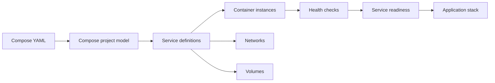

🗓️ 11112024 1450

# compose

> **Docker Compose**: A tool for defining and running multi-container applications from a Compose file. ([Docker Docs](https://docs.docker.com/compose/))

Compose replaces repeated container commands with a declarative service, network, and volume model.

## Overview
- Tool for defining and running multi-container applications
- Uses YAML configuration file
- Single command starts entire application stack with dependencies, networks, volumes

## Problem addressed
- Running multi-container apps with `docker run` means typing long commands for each service
- Must manually create networks, manage startup order, remember all flags
- Compose replaces this with declarative config file and simple commands

## Structure

A `docker-compose.yml` defines:

### Services
- Containers to run
- Each service specifies image/build context, ports, environment variables, dependencies, health checks
- For selectively running subsets, see [[compose_profiles]]
- For reusing service definitions across clients, see [[compose_extends]]

### Networks
- How containers communicate

### Volumes
- Persistent data

## Use cases

Use for:
- Multi-container applications (app + database + cache)
- Local development environments with multiple services
- Integration testing requiring full stack
- Small single-host production deployments

Skip for:
- Single containers (just use `docker run`)
- Production at scale (use [[orchestration]] like Kubernetes)
- Multi-host deployments needing auto-scaling and rolling updates

## Dependency Management

`depends_on` controls startup order:
- Only waits for containers to start, NOT for services to be ready
- Combine with `condition: service_healthy` to wait for [[healthcheck]] to pass
- Without health checks, app might try connecting to database that's still initializing
- For advanced dependency strategies including init containers, see [[compose_dependencies]]

## Environment Variables and Config

Configuration options:
- Set inline in YAML
- Load from `.env` files
- Substitute from host environment
- Mount config files via volumes

Pattern: Use environment variables for secrets and runtime config, mount files for complex configuration. For detailed patterns, see [[env_management]].

## Compose vs Orchestration

Differences:
- Compose: Single-host, development-focused
- orchestration: Multi-host, production-grade
- Compose orchestrates containers but doesn't manage clusters
- Many start with Compose for dev, move to Kubernetes for prod

For production needing auto-scaling, rolling updates, self-healing: use orchestration platforms.

## Common Pitfalls

```ad-warning
**Ignoring health checks**: Using `depends_on` without health checks means dependent services start before dependencies are ready. Always add healthcheck to services that need startup time.
```

```ad-danger
**Using Compose for production scale**: Compose has no auto-scaling, no rolling updates, no multi-host support. Great for single-host deployments but not designed for production scale. Use orchestration platforms instead.
```

For resource constraints per service, see [[resource_limits]]. For log management, see [[logging]].



---

## References

- https://docs.docker.com/compose/
- https://docs.docker.com/compose/compose-file/
