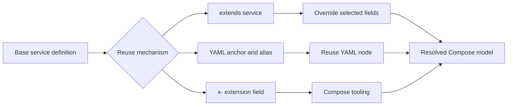

🗓️ 03042026 2100

# compose_extends

Compose configurations can reuse common service settings through `extends`, YAML anchors, and extension fields.

## Terms

| Term | Definition | Source |
|---|---|---|
| **`extends`** | A Compose service attribute that reuses another service definition and allows selected overrides. | [Docker Docs](https://docs.docker.com/compose/extends/) |
| **YAML anchor and alias** | YAML features that name a node and reuse it elsewhere in a document. | [YAML 1.2.2](https://yaml.org/spec/1.2.2/) |
| **Extension field** | A Compose field beginning with `x-` that Compose ignores for service configuration. | [Compose Specification](https://github.com/compose-spec/compose-spec/blob/main/11-extension.md) |

## Problem addressed

- Multi-client setups duplicate service definitions across files
- Copy-pasting configs leads to drift — change one, forget the others
- Need a way to define a base service once and override per client or environment

## extends Keyword

Pulls base service config from another file or same file, then overrides specific fields:
- `extends.file` + `extends.service` references a base definition
- Overriding file adds or replaces fields on top of base
- Good for per-client overrides: `base.yml` defines the service, `client-a.yml` extends and customizes

### Limitations
- Cannot extend services that use `depends_on` with `condition` — restructure dependencies in the extending file
- Lists (like `ports`, `volumes`) are appended, not replaced — can lead to duplicates
- Single inheritance only — no chaining extends through multiple levels

## YAML Anchors and Aliases

DRY within a single file using native YAML:
- `&anchor` defines a reusable block
- `*anchor` references it
- `<<: *anchor` merges the block into current mapping

### Choosing a reuse method
- Repetitive config within one file (same [[logging]] config, same resource limits for all services)
- Simpler than extends for same-file reuse

## x- Extension Fragments

Compose ignores top-level keys starting with `x-`:
- Define reusable blocks as `x-common-env`, `x-logging`, etc.
- Reference with YAML anchors
- Cleaner than anchors buried inside service definitions
- Compose v2+ feature

## Choosing a registry

### extends
- Cross-file reuse (base.yml + per-client overrides)
- Environment-specific configs (dev.yml extends base.yml)

### Anchors / x- fragments
- Same-file repetition (shared logging, labels, deploy config)
- Quick DRY without extra files

### Separate compose files
- When clients need fully isolated namespaces and you combine with [[compose_profiles]] isn't sufficient
- `docker compose -f base.yml -f client-a.yml up`

## Trade-offs

### extends
- Compose-aware, readable, explicit inheritance
- Limited: no list merging control, no multi-level chaining

### YAML anchors
- Flexible, works at YAML level
- Harder to debug — resolved before Compose processes the file, mistakes produce silent wrong config

```ad-warning
**extends + depends_on condition**: `extends` cannot extend services using `depends_on` with `condition: service_healthy`. Move dependency declarations to the extending file instead.
```

```ad-danger
**Silent anchor failures**: YAML anchors are resolved before Compose validates the file. A typo in an anchor name or wrong merge produces incorrect config with no Compose-level error — only runtime surprises.
```



---

## References

- https://docs.docker.com/compose/extends/
- https://docs.docker.com/compose/compose-file/11-extension/
