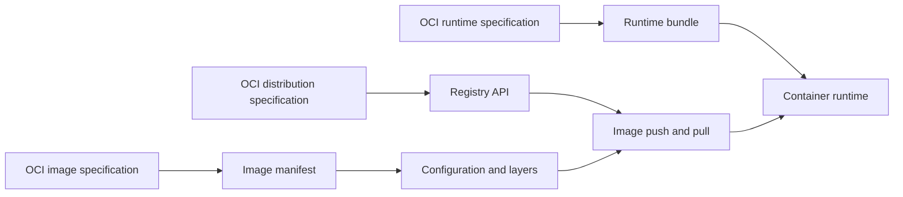

🗓️ 03042026 2100

# oci_spec

> **Open Container Initiative (OCI)**: An open-governance project that defines standards for container images, runtimes, and distribution. ([OCI](https://opencontainers.org/))

OCI standards let container images and runtimes interoperate across implementations.

## Overview
- **Open Container Initiative** — industry standards for container image format, runtime, and distribution
- Ensures containers built by one tool work with any compliant runtime
- Governed by the Linux Foundation, backed by Docker, Google, Red Hat, and others

## Problem addressed
- Without standards, images built with Docker only work with Docker's runtime — vendor lock-in
- Cloud providers and tools each inventing their own format means no portability
- OCI standardizes the "contract" so the ecosystem can interoperate

## Three Specifications

### Runtime Spec
- How to run a container: filesystem bundle, lifecycle (create, start, stop, delete), environment setup
- Reference implementation: `runc` (used by Docker under the hood)

### Image Spec
- How to package a container image: layer format, manifest, configuration
- Defines the portable format that registries and runtimes agree on
- Docker images are OCI-compliant since Docker v1.10+

### Distribution Spec
- How to push and pull images from [[container_registries]]
- Standardizes the HTTP API for image transfer
- Any OCI-compliant registry works with any OCI-compliant client

## Docker's Relationship to OCI

- Docker donated its image format and runtime (`runc`) to OCI as the starting point
- Docker Engine uses `containerd` → `runc` (both OCI-compliant) under the hood
- Docker images are OCI images — no conversion needed
- Docker CLI is one of many OCI-compliant tools (others: Podman, Buildah, Skopeo)

## Cases where OCI compatibility matters

Matters when:
- Evaluating Docker alternatives (Podman for rootless containers, containerd for lighter footprint)
- Choosing container registries — OCI-compliant registries accept images from any OCI builder
- Ensuring portability across cloud providers (AWS, GCP, Azure all support OCI)
- Docker licensing changes affect your deployment — OCI compliance means you can switch runtimes

Ignore when:
- Staying within Docker ecosystem with no plans to evaluate alternatives
- Local development where tooling choice doesn't impact production

## Trade-offs



### OCI compliance = portability
- Freedom to switch between Docker, Podman, containerd without rebuilding images
- All major cloud providers support OCI natively

### Not identical behavior
- OCI compliance means the format is interoperable, not that every runtime behaves identically
- Edge cases exist: signal handling, cgroup v2 support, security module integration
- Test with your target runtime before switching in production

```ad-warning
**OCI compliance does not mean identical runtime behavior**: Edge cases exist between runtimes (signal handling, cgroup v2 support, seccomp profiles). Always test your containers on the target runtime before committing to a switch from Docker.
```

---

## References

- https://opencontainers.org/
- https://github.com/opencontainers/runtime-spec
- https://github.com/opencontainers/image-spec
