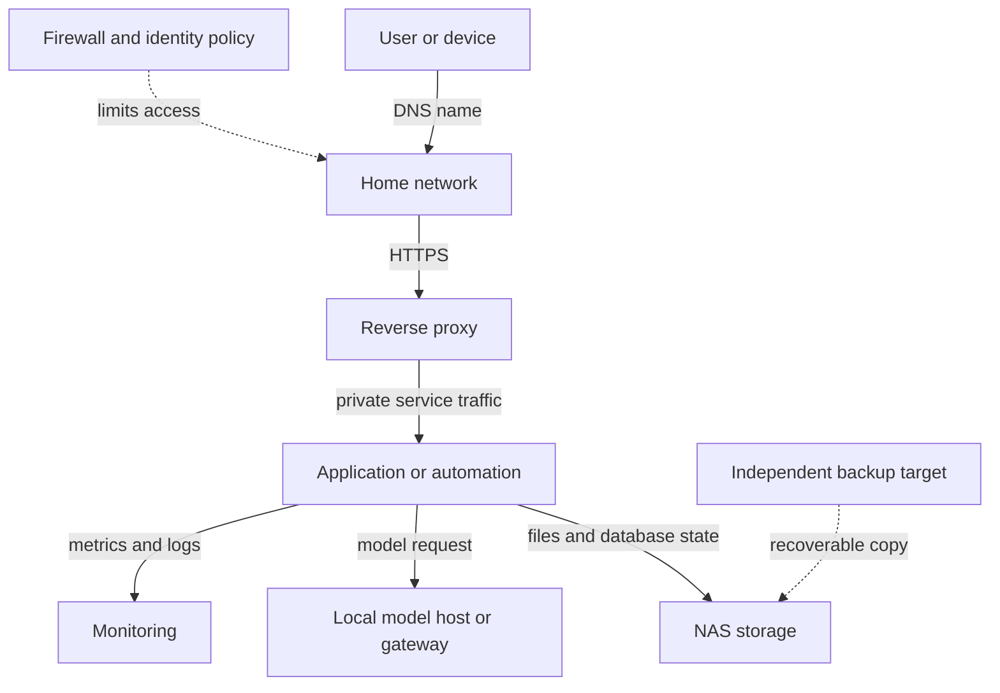

🗓️ 11102026 1535

# index

This path starts with NAS fundamentals, then adds services and workloads. Synology DSM is the running example. Model-dependent features are called out.

## Learning path

### 1. Understand the NAS and its foundations

1. [[nas_fundamentals]] — NAS hardware, DSM, and file access.
2. [[networking]] — addresses, discovery, and network paths.
3. [[for_self_hosting]] — Linux processes, users, and services.
4. [[virtualization_containers]] — VM and container boundaries.
5. [[storage_raid_backups]] — disks, RAID, snapshots, and backups.

### 2. Make services reachable and operable

6. [[service_access]] — DNS, proxies, TLS, and remote access.
7. [[workloads]] — apps, databases, and development environments.
8. [[observability]] — signals and failure diagnosis.
9. [[security_maintenance]] — access controls, updates, and recovery.

### 3. Add specialized workloads

10. [[self_hosted_ai]] — local models, gateways, and MCP servers.
11. [[rag_agents]] — retrieval and controlled agent workflows.
12. [[smart_home]] — devices and automations with Home Assistant.

## How the pieces fit

The NAS need not run every service. Separate storage from compute when useful. Track access policy, service state, and backup copies independently.

## First integrated project

Deploy a small app and database with Compose. Add persistent storage, local DNS, HTTPS, and a backup. Monitor the stack and restore its data. Later, add Ollama or a Home Assistant sensor.

## References

- [[learning_path]]
- [[learning_path]]
- [Synology DSM help](https://kb.synology.com/en-us/DSM/help/DSM/Overview)
