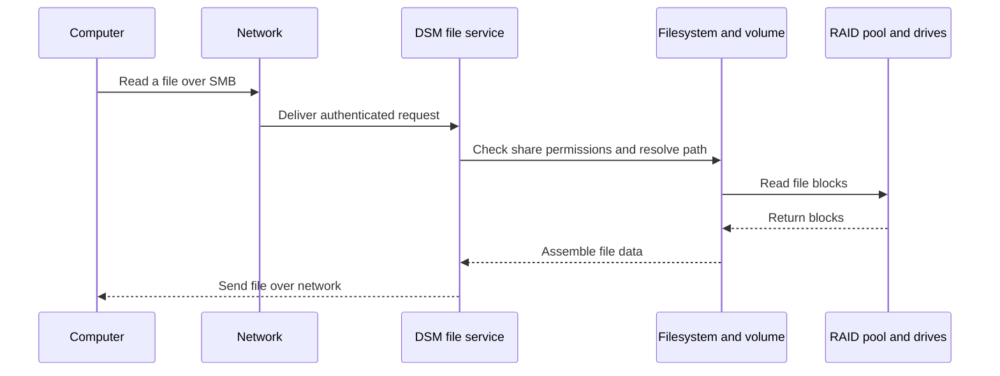

🗓️ 11102026 1535

# nas_fundamentals

> **Network-attached storage (NAS)**: A storage system that provides file access to clients over a network. ([SNIA glossary](https://www.snia.org/education/what-is-a-nas))

Synology combines disks, network interfaces, and DSM management software, letting clients share data and services.

## Operational impact

A NAS centralizes files, permissions, and backups. It can also run applications. Storage reliability, compute capacity, and service availability remain separate concerns.

## Hardware and software path

- Drives persist data blocks. HDDs favor capacity; SSDs reduce latency.
- CPU and memory run DSM, services, apps, and VMs.
- Network interfaces carry client requests. Link speed limits throughput.
- DSM manages users, storage, shared folders, and packages.
- Package support varies by model and DSM version.
- See [[for_self_hosting]] for underlying Linux concepts.
- SMB and NFS share files; iSCSI exposes block devices.

File access crosses several layers. The network, identity, permissions, filesystem, and drives must work together.

## Synology as the example

DSM provides browser-based administration and packages for sharing, backup, and applications. Container and virtualization tools depend on model support. Check model specifications before deployment.

## Trade-offs and alternatives

| Design | Useful when | Cost or limit |
|---|---|---|
| Design | Useful when | Trade-off |
|---|---|---|
| NAS appliance | You want integrated storage management | Vendor features and hardware choices vary |
| OpenMediaVault or TrueNAS server | You want hardware and software control | You manage more configuration and maintenance |
| Cloud storage | You need off-site, elastic capacity | Recurring cost and provider dependence |
| NAS plus compute host | Storage and compute needs differ | More devices and operations |

## Hands-on project

Create a test share and non-admin user. Connect over SMB. Trace a file read, then revoke access and identify where it fails.

## References

- [Synology DSM help](https://kb.synology.com/en-us/DSM/help/DSM/Overview)
- [SMB 3.1.1 specification overview](https://learn.microsoft.com/en-us/openspecs/windows_protocols/ms-smb2/)
- [[networking]]
- [[storage_raid_backups]]
