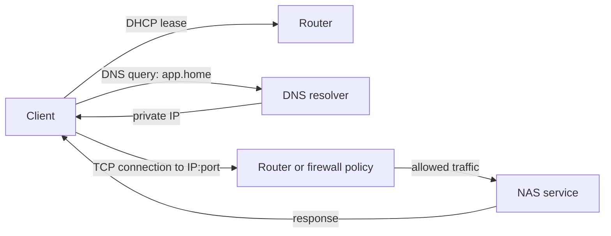

🗓️ 11102026 1535

# networking

A home network carries traffic between clients, NAS services, and the internet. Addressing and routing explain why access can differ between devices.

## The request path

1. DHCP gives the client an address and network settings.
2. DNS resolves the hostname to an IP address.
3. The client sends packets to an address and port.
4. Routers forward traffic; firewalls permit or block flows.
5. The service accepts the connection and returns a response.

**DHCP assigns addresses; DNS maps names to addresses.** DNS does not open firewall paths or start services. A port identifies an endpoint, not a security boundary.

## Segmentation and discovery

An IP subnet defines which addresses are local. Routers connect subnets. VLANs separate logical networks over shared hardware. Firewall rules control traffic between them. For example, IoT devices can reach Home Assistant without reaching NAS administration.

Start with a flat LAN. Add VLANs when you can define boundaries and required flows. Segmentation adds troubleshooting work. Some discovery traffic does not cross VLANs automatically.

## Tools and alternatives

- Test with `ip`, `ping`, `dig`, and `ss`.
- DHCP reservations keep local addresses stable.
- AdGuard Home and Pi-hole provide local DNS.
- Local resolvers need updates and backups.
- Managed switches and access points can provide VLANs.

## Hands-on project

Reserve a NAS address and resolve a test name. Check its route and port from two clients. Block one test path and identify the failing layer. Preserve router management access.

## References

- [[modem_vs_router]]
- [[networking_connectivity]]
- [[networking_dns_tools]]
- [RFC 2131: DHCP](https://www.rfc-editor.org/rfc/rfc2131)
- [RFC 1034: DNS concepts](https://www.rfc-editor.org/rfc/rfc1034)
