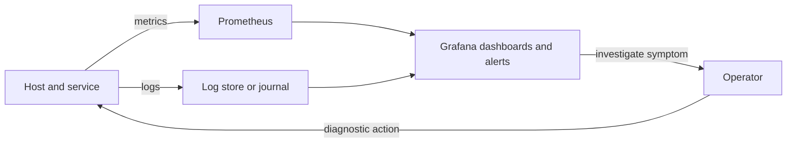

🗓️ 11102026 1535

# observability

Observability uses emitted signals to infer system health. A service may fail from deployment, storage, networking, or resource problems. Each cause needs a different fix.

## Follow the evidence

Metrics measure values over time; logs record events. Dashboards summarize signals but do not prove causes. High CPU may reflect useful work, a loop, or contention. Check related signals before changing configuration.

## A practical starting stack

- Prometheus collects metrics; Grafana displays them. See [[metrics_learning_path]].
- node_exporter exposes Linux host metrics.
- cAdvisor reports container resource use.
- Alertmanager routes actionable Prometheus alerts.
- Start logs with the host journal and container output.
- Loki enables cross-service search but adds maintenance.

DSM exposes some health information. Exporters depend on host support and deployment. Avoid broad host permissions; understand each exporter's access needs.

For Linux process and log basics, see [[for_self_hosting]].

## Hands-on project

Monitor a Linux host and container. Dashboard CPU, memory, disk, and restarts. Stop the test service. Compare metric and log changes with the user-visible symptom.

## References

- [[metrics_learning_path]]
- [[node_exporter_host_metrics]]
- [[cadvisor_container_metrics]]
- [[health_checks]]
