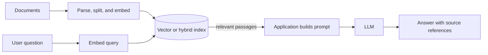

🗓️ 11102026 1535

# rag_agents

Retrieval-augmented generation adds retrieved information to a model request. An agent uses a model to choose steps and tools toward a task.

## Terms

| Term | Definition | Source |
|---|---|---|
| **Retrieval-augmented generation (RAG)** | A method that retrieves relevant information and provides it as context to a generative model. | [AWS](https://docs.aws.amazon.com/sagemaker/latest/dg/jumpstart-foundation-models-customize-rag.html) |
| **AI agent** | A system that uses a model to decide actions and may call tools to complete a task. | [OpenAI](https://platform.openai.com/docs/guides/agents) |

## RAG data and query paths

Ingestion splits documents and creates embeddings. The index stores text, metadata, and vectors. Queries retrieve passages for the prompt. Chunking, embeddings, filters, and ranking affect results. Enforce access controls during retrieval to prevent data leaks.

## Agent control loop

An agent sends a goal to a model. It checks proposed calls, runs allowed tools, and returns results. The application limits turns, time, access, and side effects. MCP standardizes tool connections; the host still owns authorization. See [[tool_invocation_flow]] and [[custom_servers]].

## Tools and trade-offs

- Qdrant stores vectors; pgvector keeps them in PostgreSQL.
- SQLite or memory indexes suit small experiments.
- Ollama supports local embeddings when hardware permits.
- Hosted models reduce local compute but transmit data.
- Hybrid retrieval combines vector and keyword search.
- Agents add uncertainty and side effects.
- Start read-only; confirm destructive actions explicitly.

## Hands-on project

Index non-sensitive Markdown files. Ask passage-specific questions and show sources. Compare vector and keyword results. Add one read-only MCP tool. Log calls, permissions, and results.

## References

- [[vector_search]]
- [[llm_tool_use]]
- [[agentic_design_patterns]]
- [MCP overview](../../ai/mcp/mcp.md)
- [Qdrant documentation](https://qdrant.tech/documentation/)
- [pgvector](https://github.com/pgvector/pgvector)
