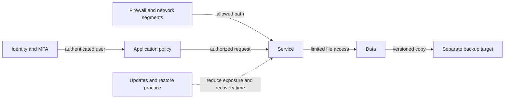

🗓️ 11102026 1535

# security_maintenance

Security limits who can reach services, what accounts can do, and how failures spread. Maintenance keeps controls and recovery paths effective as systems change.

## Identity and network boundaries

Authentication establishes identity; authorization grants actions. Use unique accounts and strong credentials. Enable MFA where supported. Reserve admin access for administration. Limit each service's permissions and network paths.

Network isolation and app authorization solve different problems. A firewall can prevent a guest or IoT device from reaching DSM; it does not decide which files an authenticated application user can read. Use both controls where the risk warrants the complexity.

## A maintenance loop

1. **Inventory** services, owners, data paths, and update sources.
2. **Patch** after checking release notes and compatibility.
3. **Back up** to a separate failure domain.
4. **Verify** backups by restoring files and services.
5. **Review** accounts, ports, storage health, and alerts.

Snapshots do not replace off-device backups. Monitoring detects problems; it does not fix them. Document local access if DNS, proxy, or VPN fails.

## Common choices

- Use DSM accounts and least-privileged service identities.
- Use a VPN for private remote administration.
- Keep admin interfaces off public routes.
- Store unique credentials in a password manager.
- Document protected account-recovery methods.
- Check compatibility before updating DSM or containers.
- Pair container updates with rollback or restore plans.
- Encrypt off-site backups; protect keys separately.

## Hands-on project

Inventory each service's data, exposure, account, backup, and update owner. Review router forwarding rules. Restore a test file. Keep local recovery access before network changes.

## References

- [[authentication_flows]]
- [[tls]]
- [[ssh]]
- [[storage_raid_backups]]
- [Synology backup guidance](https://kb.synology.com/en-id/DSM/help/DSM/Tutorial/backup_backup)
