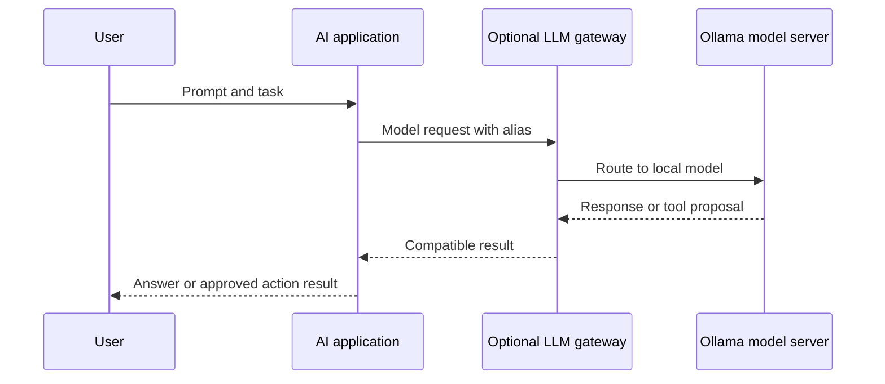

🗓️ 11102026 1535

# self_hosted_ai

> **Inference**: The process of using a trained model to produce outputs from inputs. ([Hugging Face](https://huggingface.co/docs/transformers/llm_tutorial))

A self-hosted AI stack runs model services and data on infrastructure you control. The model generates responses; gateways route requests; applications manage context and permissions.

## Request path

Ollama serves models through a CLI and HTTP API. LiteLLM can route model aliases through a common API. Gateways also receive prompts and credentials. Tool calls remain proposals; applications authorize and execute them. See the [LLM gateway](../../ai/gateway/gateway.md), [[llm_tool_use]], and the [MCP overview](../../ai/mcp/mcp.md).

## Where to run inference

Inference depends on model size, quantization, memory, accelerators, and concurrency. Some NAS models lack compute for useful inference. Run Ollama on another host when needed. Keep models and datasets on the NAS only when storage performance fits.

Local inference reduces provider sharing but does not guarantee privacy. Logs, backups, gateways, and tools may expose data. Remote APIs avoid local hardware costs but add provider and network dependencies.

## Tools and trade-offs

- Ollama serves local models; alternatives vary in hardware support.
- LiteLLM routes compatible model requests.
- Direct Ollama access is simpler for one client.
- MCP servers expose tools and resources.
- Hosts select servers and enforce authorization.
- See [[architecture]] and [[authorization]].
- Use another host when NAS compute is insufficient.
- Hosted models trade local control for provider dependence.

## Hands-on project

Run a small model and measure memory and latency. Call it from a minimal app. Add a gateway and second route. Check which services receive prompts and credentials.

## References

- [[model_applications]]
- [[operations]]
- [[request_routing]]
- [MCP overview](../../ai/mcp/mcp.md)
- [Ollama documentation](https://docs.ollama.com/)
- [Ollama official Docker image](https://ollama.com/blog/ollama-is-now-available-as-an-official-docker-image)
